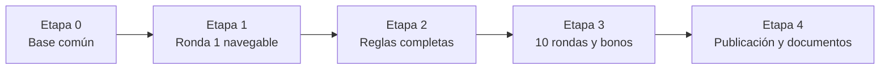

# Plan de trabajo del proyecto final: Bosconian (Sharp X68000)

Este documento reúne, en un solo lugar, todo lo que el grupo necesita para construir y entregar el proyecto final del curso. Primero resume lo que nos piden. Después describe lo que ya existe en el repositorio y lo que conviene corregir, explica cómo se comporta el juego original con todos sus números y organiza el trabajo en etapas que crecen de a poco. Así, los cuatro integrantes pueden avanzar en paralelo sin bloquearse entre sí. Al final hay una lista de verificación y dos anexos con la posición exacta de las bases y de los obstáculos de cada ronda.

Todo lo que este documento dice sobre el juego original salió de jugarlo y medirlo en el emulador del curso, cuadro a cuadro y sin sonido, y de revisar dos videos de referencia. El original corre a 55,46 cuadros por segundo. Por eso los tiempos de este documento están convertidos a segundos y las velocidades a píxeles por segundo, para que se puedan usar directamente con el delta time del motor.

---

## 1. Qué nos piden

### 1.1 El producto

El curso pide una **reproducción exacta** de Bosconian en la versión que hicieron Namco y Dempa para la computadora Sharp X68000 en 1988. El enunciado insiste en que no se trata de un juego "parecido" ni "inspirado en" el original. Tiene que replicar sus dimensiones, sus sonidos y su comportamiento.

Además hay reglas técnicas que aplican a todo el proyecto:

- El juego se programa solamente con **Pygame y Esper**, y la única ayuda externa permitida es la lectura de archivos JSON.
- La arquitectura tiene que ser **ECS en la mayor parte del código**. Si el proyecto no usa ECS en su mayoría, el curso no lo acepta, aunque cumpla todo lo demás.
- La resolución es de **256 x 208 píxeles en total**, o de 256 x 256 con franjas negras de 24 píxeles arriba y abajo.
- Todas las definiciones del juego (niveles, jugador, enemigos y recursos) viven en **archivos externos de configuración**, en lugar de estar escritas dentro del código.
- El juego se publica en **itch.io**, en versión web.
- El repositorio es **privado**, y los profesores y monitores tienen que tener acceso.
- Todos los integrantes programan, y el historial de git tiene que mostrar el trabajo progresivo de cada uno a lo largo de las semanas.
- Los recursos tienen que respetar los derechos de autor y el tamaño original del juego. Todas las imágenes, videos y audios que usemos son de uso libre, y el audio va siempre en formato OGG, que es el que funciona en la versión web.

### 1.2 Requisitos obligatorios del juego y su puntaje

El juego publicado vale 20 puntos. Cinco de esos puntos corresponden a que el juego esté publicado con una descripción y un pantallazo. Los otros quince se reparten en un punto por cada sistema de esta tabla. La última columna indica en qué etapa del plan (sección 7) se construye cada uno.

| Requisito de la rúbrica | Qué significa en concreto | Etapa |
|---|---|---|
| Juego publicado con descripción y pantallazo (5 puntos) | Una página de itch.io con el juego web, un texto que lo describe y al menos una captura | 0 (borrador) y 4 (final) |
| Escena de intro, 10 niveles con interfaz de ronda, instrucciones y créditos | Diez rondas jugables, el número de ronda visible en el panel, una pantalla de instrucciones y una de créditos | 1, 2 y 3 |
| Fondo de estrellas con color, parpadeo y movimiento | Estrellas de colores al azar que parpadean y se mueven; en los menús caen de arriba hacia abajo | 1 |
| Escenas de juego, victoria y derrota | La partida, la pantalla de victoria al terminar la ronda 10 y la de game over con la opción de continuar | 2 |
| Cámara del jugador y parallax de estrellas | La cámara sigue a la nave y las estrellas se mueven a la mitad de esa velocidad | 1 |
| Minimapa | Muestra al jugador y a las bases, y da la vuelta igual que el mundo | 1 |
| Wraparound de todas las entidades | Todo lo que sale por un borde del mundo aparece por el borde opuesto, en horizontal y en vertical | 1 |
| Jugador con aceleración, muerte con explosiones y vidas | Movimiento automático acelerado en 8 direcciones, disparo doble, muerte con varias explosiones y vidas | 1 y 2 |
| Habilidad especial definida por nivel | El disparo especial de cuatro balas (tres al frente y una atrás), activo en algunas rondas | 3 |
| Bases con núcleo normal y animado | Bases horizontales y verticales con seis cañones que disparan y un núcleo que, según la ronda, queda abierto o se abre y se cierra lanzando un misil E | 1 y 2 |
| Enemigos I, P y E con persecución | Naves que aparecen por los bordes, persiguen al jugador con su propio comportamiento y explotan al morir | 1 y 2 |
| Obstáculos | Rocas, minas animadas con explosión letal y rocas indestructibles que se mueven | 1, 2 y 3 |
| Colisiones con hitbox | Choques rectangulares (AABB) con un componente de hitbox aparte, entre jugador, enemigos, balas, bases y obstáculos | 2 |
| Puntaje y puntaje máximo, con vidas | Puntaje, un HI-SCORE que arranca en 20.000 y vidas extra | 2 |
| Alertas verde, amarilla y roja (la roja por tiempo) | La condición del panel cambia con el tiempo y con los eventos de la ronda | 2 |
| Sonidos por evento y música por escena | Un sonido para cada evento importante y música distinta para el menú, las rondas y las escenas | 2 y 3 |

### 1.3 Bonos

Los bonos suman hasta un 10 % adicional sobre la nota, y el grupo los hace todos. Se construyen después de tener los obligatorios funcionando, en este orden, que va de menor a mayor costo:

1. felicitación de puntaje máximo;
2. intro animada;
3. modo atractor con instrucciones;
4. cutscene al empezar;
5. gamepad;
6. enemigo espía con su alerta;
7. ataques en formación con alerta y minimapa;
8. segunda habilidad no letal;
9. nivel jefe;
10. modo editor.

El modo editor vale por dos bonos, como dijo el profesor en la sesión del 4 de noviembre, y el curso lo enseña paso a paso en la semana 6. Por eso el frente B lo empieza apenas cierre sus obligatorios, sin esperar a los demás bonos.

### 1.4 Entregables y su peso en la nota

| Entregable | Peso | Qué incluye |
|---|---|---|
| Juego publicado | 20 % | Lo de la sección 1.2 |
| Código fuente | 10 % | Enlace al repositorio con un tag final y uso visible de ECS (2 puntos), más un punto por cada uno de estos: game loop, Command, State, Service Locator, Escena, archivos de configuración, enlace al repositorio y que el código corresponda al juego publicado |
| Documento de arquitectura y post-mortem grupal | 10 % | Resumen del proceso semana a semana, análisis de la arquitectura con diagramas, análisis de los patrones (sobre todo ECS) y reflexión sobre qué salió bien, qué salió mal y qué cambiaríamos |
| Post-mortem individual | 10 % | Cada integrante describe su rol y su trabajo, qué salió bien y mal a título personal y qué aprendió |
| Video de presentación | 10 % | Presenta el juego y al equipo, explica la arquitectura (componentes, sistemas, configuraciones y patrones) y el trabajo de cada persona |

El curso recomienda además un **modo trampa** documentado en el README, para que quien califica pueda ver todas las funciones del juego sin tener que jugarlo completo. La sección 5.20 lo define.

### 1.5 Cómo decidimos cuando hay diferencias

El curso entrega una lista de chequeo con lo que espera ver en el juego, y esa lista es la guía con la que se revisa el proyecto. En algunos puntos la lista describe un comportamiento distinto al del original de X68000, porque muchas de sus frases salen de una guía de estrategia de la versión de arcade. Por eso usamos este criterio, en este orden:

1. **Manda la lista de chequeo.** Si la lista pide algo de una forma, se hace de esa forma, sobre todo en el puntaje.
2. **Lo que exige el enunciado también se cumple**: minas con explosión letal, rocas indestructibles y habilidad especial definida por nivel.
3. **El original completa lo que la lista deja abierto**: los tiempos, las velocidades, las posiciones de las bases y de los obstáculos, los textos de las escenas, el panel y todos los detalles que la lista no menciona. Para eso medimos el original.
4. **Los derechos de autor van primero.** Por eso el juego usa el logo COSMONIAN que entrega el curso y no muestra el nombre ni el logo de Namco.

Estas son las diferencias concretas entre la lista y el original. En todas, nuestro juego hace lo que pide la lista:

| Tema | El original hace | Nuestro juego hace (lista de chequeo) |
|---|---|---|
| Vida extra | Una cada 50.000, con un máximo de 4 vidas de reserva | Una a los 50.000, otra a los 100.000 y luego una cada 100.000 (200.000, 300.000...). Si hay más de 4 vidas, un número en la esquina inferior derecha de las vidas muestra el total |
| Velocidad de los enemigos | El I y el P son un poco más lentos que el jugador hasta la ronda 9 | Siempre un poco más rápidos que el jugador |
| Enemigos en alerta roja | Mantienen la velocidad y salen casi al doble de ritmo | Van más o menos al doble de velocidad y salen al doble de ritmo |
| Enemigo I | Persigue mientras está en pantalla | Persigue y se va después de un rato |
| Enemigo P | Persigue unos 2 segundos y luego se aleja en arco, en ciclos | Persigue y rápidamente se vuelve aleatorio |
| Puntos del espía | 200, 400, 500 u 800 al azar | 200, 400, 800 o 1600 según la distancia al eliminarlo |
| Espía en el borde | Sale, vuelve a entrar un poco y se va | La primera vez rebota en el borde y la segunda vez sale |
| Puntos de la formación | Cada nave vale lo de su tipo, la líder el doble, y hay un bono de 500 o 1000 | El capitán vale 90 y eliminar toda la formación da 1500 |
| Nave de la formación | I o P al azar | Cualquier tipo salvo el espía: I, P o E |
| Frecuencia de la formación | La misma en todas las rondas | Más frecuente cuanto más difícil es la ronda |
| Alerta roja | Baja a verde al morir el jugador | No se puede bajar de roja |
| Pausa | Todo queda congelado y visible con "PAUSE!" | Los enemigos, el jugador y el minimapa desaparecen, las estrellas quedan quietas pero brillando, aparece "JUEGO PAUSADO" y se puede abrir el menú de opciones |
| Cuenta para continuar | Unos 5,4 segundos | Un máximo de 5 segundos |
| Felicitación de récord | Solo al perder | Al perder y al ganar |
| Habilidad especial | Se activa por cuenta regresiva en rondas posteriores a la 10 y se pierde al morir | Se define por nivel y se anuncia con un mensaje al principio del nivel |
| Cañones | Disparan solo si el jugador va a su velocidad máxima | Disparan al estar cerca del jugador, cada uno a su propio intervalo |
| Explosión de la mina | Solo visual | Letal y de otro color |
| Rocas indestructibles | No aparecen en las rondas 1 a 10 | Se mueven en una dirección al azar y nada las destruye |

---

## 2. El equipo y la forma de trabajar

### 2.1 Cuatro frentes de trabajo

Somos cuatro integrantes, así que el trabajo se divide en cuatro frentes que tocan archivos distintos. De esa manera cada persona avanza sin pisar el código de otra. El reparto aprovecha lo que cada uno ya hizo.

| Frente | Responsable | Qué construye |
|---|---|---|
| **A. Motor, mundo y jugador** | Daniel, que ya construyó el motor, las escenas base y la cámara | Correcciones del motor, mundo que da la vuelta, cámara, estrellas, minimapa, jugador, disparos, EXTRA CANNON, segunda habilidad y gamepad |
| **B. Bases, obstáculos, colisiones y niveles** | Jonatan | Archivos de los diez niveles, bases con cañones y núcleo, misil E desde el núcleo, rocas, minas, rocas indestructibles, sistema de colisiones y modo editor |
| **C. Enemigos, alertas y puntaje** | Juan | Enemigos I y P, aparición de enemigos, alertas, puntaje, récord, vidas, panel, formación y espía |
| **D. Escenas, sonido y presentación** | Jerson | Título, opciones, instrucciones, créditos, pausa, game over, victoria, felicitación de récord, intro, modo atractor, cutscene, efectos de sonido, música y nivel jefe |

El modo trampa es de todos: el frente A construye el mecanismo y cada frente agrega las acciones de lo que construye. Los documentos y el video también son de todos.

### 2.2 Reglas de trabajo en el repositorio

- Cada tarea se trabaja en una rama propia y entra a `main` con un pull request pequeño, que revisa otro integrante.
- Cada integrante hace commits con su propia cuenta, varias veces por semana, para que el historial muestre el trabajo progresivo de todos.
- Antes de pedir revisión, quien hace el cambio corre el juego en escritorio. Además, una vez por semana alguien construye la versión web para detectar a tiempo los problemas de pygbag.
- Los valores del juego se leen de los JSON. Si una tarea necesita un número, lo toma de la sección 5 de este documento y lo escribe en el archivo de configuración que corresponde.
- Todo el código sigue el patrón ECS tal como lo enseña el curso, con las reglas de la sección 4.1. Quien revisa un pull request comprueba esas reglas antes de aprobarlo.
- Cada persona entiende y puede explicar el código que sube, porque el video y los post-mortem piden explicar el trabajo de cada uno.

---

## 3. Lo que ya existe en el repositorio

El repositorio es `dso-uniandes/bosconian`, en la rama `main`. Al 14 de noviembre lleva 91 commits y once pull requests unidos.

### 3.1 Lo que está hecho y se conserva

- **Game loop asíncrono con delta time**, en `src/engine/game_engine.py`. Usa `async def run` y `await asyncio.sleep(0)`, limita el delta time con `min_framerate` y cambia de escena al final del cuadro.
- **Lienzo de 256 x 208** escalado a mano al tamaño de la ventana, sin `pygame.SCALED`, y `import pygame` en `main.py`, que es lo que pide pygbag.
- **Service Locator** con servicios de configuración, imágenes y fuentes.
- **Escenas**: `TitleScene` y `GameScene(engine, round_number)`, que lee `levels/level_NN.json`.
- **Patrón Command**: `CInputCommand`, `system_input_event` y `system_input_commands`, con las teclas en `input.json`.
- **Mundo de 1024 x 1536 que da la vuelta**, cámara que sigue al jugador, estrellas con parallax y parpadeo, y minimapa.
- **Jugador** con 8 direcciones, aceleración, disparo, EXTRA CANNON y estados con `CPlayerState`.
- **Modo trampa** con `CCheatMode` y su indicador en el panel.
- **Niveles**: `levels/level_01.json` a `level_10.json`, generados con `tools/gen_levels.py`, y el componente `CHitbox`.
- **Rocas, minas y bases** con sus cañones y su núcleo, cada pieza como una entidad.
- **Enemigos I y P** con su spawner y su máquina de estados, **alertas** y **puntaje**, con pruebas que corren sin ventana en `tests/`.
- **Archivos del proyecto**: `README.md`, `requirements.txt` (pygame-ce, pygbag y pytest) y `.gitignore`.

Las convenciones que ya existen en el código se mantienen: nombres en inglés, funciones `create_*` para crear entidades, el componente `CInputCommand` y las etiquetas en `src/ecs/components/tags/`.

### 3.2 Ajustes de arquitectura antes de seguir construyendo

El curso califica la arquitectura además del juego, y su lista de malos olores de ECS es la vara con la que se revisa el código. Estos ajustes alinean lo que existe con esa lista y con los patrones de las semanas 4 a 6. Van primero porque las escenas nuevas se construyen encima.

1. **Interfaz de escena del curso.** Hoy la clase `Scene` solo trae `create`, `do_events`, `update` y `draw`, y el motor conoce cada escena concreta con `change_to_title` y `change_to_game`. Pasa a la forma del curso, descrita en la sección 4.2: la escena es dueña de su mundo de Esper, el motor guarda las escenas por nombre y cada escena pide el cambio con `switch_scene("NOMBRE")`.
2. **El motor solo administra escenas.** Hoy `GameEngine` carga `player.json`, `bullet.json`, `obstacles.json`, `input.json` y otros, y las escenas los leen con `self.engine.player_cfg`. El motor se queda con la ventana, el reloj y las escenas. Cada escena y cada prefab piden su JSON a `ServiceLocator.configs_service`, que ya guarda en caché lo que carga.
3. **El estado de la partida es un servicio.** `GameSession` vive hoy en el motor. Pasa a ser `ServiceLocator.session_service`, con el puntaje, el récord, las vidas, la ronda y las continuaciones, y con los métodos para guardar y cargar el récord. Es lo que sugirió el profesor en la sesión del 4 de noviembre: lo que sobrevive a los cambios de escena va en un servicio.
4. **Servicio de sonidos.** Se suma `ServiceLocator.sounds_service`, con caché como el de imágenes. Los sistemas reproducen los sonidos por su nombre de `sounds.json`.
5. **Toda tecla pasa por Command.** Hoy `GameScene.do_events` revisa la tecla de volver con un `if` directo. Esa tecla y la pausa (ESC y P) pasan a ser comandos de `input.json`, que la escena atiende en `do_action`. ESC deja de volver al título y pasa a ser la pausa, como en el original.
6. **Acceso del curso.** Confirmar que los profesores y monitores tienen acceso al repositorio, como pide el enunciado.

## 4. La arquitectura que vamos a construir

Esta sección describe en lenguaje simple las piezas del juego. Sirve como mapa para repartir el trabajo y después como base del documento de arquitectura que se entrega al final.

### 4.1 Cómo aplicamos ECS

El juego se construye con ECS sobre Esper, igual que los ejercicios del curso. Estas son las reglas que todos seguimos, con un ejemplo del curso para cada una:

1. **Una entidad es solo un número.** La crea `world.create_entity()`, y sus datos y su comportamiento vienen de los componentes que lleva.
2. **Un componente solo guarda datos.** Es una clase pequeña con el prefijo `C`, en `src/ecs/components/c_*.py`, sin métodos de juego. Por ejemplo, `CTransform` guarda la posición del **centro** de la entidad y `CHitbox` guarda el tamaño y el desplazamiento del rectángulo de choque, medido desde ese centro (`-tamaño / 2`). Se aceptan las ayudas de construcción, como `CSurface.from_surface`.
3. **Una etiqueta marca qué es una entidad.** Es una clase vacía en `src/ecs/components/tags/`, como `CTagEnemy` o `CTagBullet` en los ejercicios. Las etiquetas sirven para que un sistema pida solo las entidades que le interesan, porque Esper busca por los componentes que una entidad tiene. El tipo de una entidad lo dan sus etiquetas, en lugar de un texto que luego se pregunta con `if tipo == ...`.
4. **Un sistema hace una sola cosa sobre todas las entidades que tienen ciertos componentes.** Es una función `system_*(world, ...)` en `src/ecs/systems/s_*.py`. Por ejemplo, `system_movement` mueve todo lo que tiene `CTransform` y `CVelocity`, sin saber si es una nave o una bala. Lo que un sistema necesita recordar va en un componente.
5. **Un prefab arma una entidad.** Es una función `create_*` en `src/create/prefab_creator.py` que lee los datos de la configuración y le pone a la entidad sus componentes y su etiqueta. El prefab también traduce los datos del JSON a los valores iniciales de los componentes. El curso guarda en `CTransform` la esquina y la calcula con `position - size / 2`; aquí `CTransform` guarda el centro, porque la nave gira y su sprite cambia de tamaño en cada giro, y es `system_rendering` el que resta medio sprite al dibujar cualquier entidad.
6. **Cada tipo de entidad tiene su JSON y cada ronda dice dónde va cada cosa.** El JSON de la entidad (`player.json`, `obstacles.json`, `bases.json`) trae el sprite, el tamaño de la hitbox y sus valores fijos. El JSON de la ronda (`levels/level_NN.json`) trae las posiciones y los valores que cambian de una ronda a otra. Así lo hace el curso con `player.json` y `level_01.json`.
7. **Lo que pasa con el tiempo es una entidad más, con su componente y su sistema.** Es el patrón del spawner del curso: `CEnemySpawner` guarda los tiempos y `system_enemy_spawner` crea los enemigos cuando toca. Lo mismo vale para las alertas, el espía y las formaciones.
8. **Cada par de cosas que chocan tiene su propio sistema de colisión, y todos comparten la misma ayuda.** Como en el curso, con `system_collision_bullet_enemy` y `system_collision_player_enemy`: el sistema pide las dos etiquetas y decide qué pasa. Armar los rectángulos con `CTransform` y `CHitbox` y recorrer los pares que se tocan lo hace una sola función común, así cada sistema queda en pocas líneas y solo contiene su resultado. Copiar un sistema y cambiarle dos líneas es uno de los malos olores que revisa el curso.
9. **Las máquinas de estados guardan el estado en un componente y la lógica en un sistema.** Es el patrón State del curso: `CPlayerState` guarda el estado y `system_player_state` decide los cambios.
10. **Los sistemas se avisan con componentes, en lugar de llamarse entre sí.** Un sistema marca un dato, como `CAnimation.completed` en el curso, o crea una entidad de evento de un solo cuadro, y otro sistema la lee y la borra.
11. **Las entidades se borran de forma diferida**, con `world.delete_entity` dentro de los sistemas y `world._clear_dead_entities()` al final de cada cuadro.
12. **La escena solo arma el mundo y llama a los sistemas.** Si el `update` o el `draw` de una escena empieza a llenarse de cálculos, preguntas y asignaciones, eso pide un componente y un sistema nuevos. La lógica propia del juego vive en los sistemas, y cuando algo falla se busca ahí.
13. **Toda tecla es un comando.** Las teclas se declaran en `input.json`, se convierten en entidades con `CInputCommand` y la escena las atiende en `do_action`. Ninguna escena ni ningún sistema pregunta por una tecla directamente.
14. **Lo que vale para todo el juego es un servicio.** Configuraciones, imágenes, fuentes, sonidos y el estado de la partida se piden al `ServiceLocator`. El motor no guarda configuraciones del juego.
15. **Los enemigos se mueven con steering.** Es la técnica de la semana 7 del curso, y el profesor la recomendó para todos los enemigos móviles de Bosconian: el sistema calcula la velocidad deseada hacia el objetivo y corrige la velocidad actual hacia ella poco a poco, con un límite de giro. El giro limitado del I y del P ya sigue esa idea. La formación suma una fuerza de separación para que las naves no se encimen.

### 4.2 Motor, escenas y servicios

Esta parte sigue la forma del patrón Escena que enseña el curso en la semana 5.

- **Motor (`GameEngine`)**: corre el game loop, calcula el delta time con un tope de 1/30 de segundo para que nada atraviese un objeto en un cuadro lento, guarda las escenas en un diccionario por nombre y le pasa el control a la escena activa. Su papel es administrar la ventana, el dibujo final y las escenas. No carga configuraciones del juego ni guarda datos de la partida.
- **Cambio de escena**: una escena pide el cambio con `switch_scene("NOMBRE")`, que solo anota el nombre. El motor hace el cambio al final del cuadro: limpia la escena actual con `clean()`, toma la nueva del diccionario y llama a su `create()`.
- **Clase base `Scene`**: es dueña de su mundo, `self.ecs_world = esper.World()`, uno por escena. Trae `simulate(delta_time)`, que llama a `do_update` y luego borra las entidades muertas, y `clean()`, que vacía el mundo y llama a `do_clean`. Cada escena hija llena sus ganchos: `do_create`, `do_update`, `do_action`, `do_draw` y `do_clean`. `do_action` recibe los comandos del patrón Command.
- **Escenas**: intro, título, opciones, instrucciones, créditos, modo atractor, cutscene, juego, game over, felicitación de récord y victoria. Cada escena crea sus entidades en `do_create` llamando a los prefabs.
- **Escena de juego**: recibe la ruta del nivel al crearse, como `PlayScene("assets/cfg/level_01.json")` en el curso. Así la misma escena juega las diez rondas, el nivel jefe (`level_boss.json`) y los niveles del editor, porque todos tienen el mismo formato.
- **Pausa**: es una bandera dentro de la escena de juego, como en la demostración del curso. Con la pausa activa, `do_update` deja de correr los sistemas de juego y solo corren el parpadeo de las estrellas y el menú de pausa. Un sistema oculta a los enemigos, al jugador y los íconos del minimapa con `CVisible`, y los vuelve a mostrar al reanudar. El menú de opciones de la pausa son entidades de la misma escena.
- **Modo editor**: es otra bandera de la escena de juego, como en la demostración de la semana 6. Con el editor activo corren los sistemas del editor y se detienen los de juego.
- **Servicios del Service Locator**: configuraciones, imágenes, fuentes, sonidos, el estado de la partida y el editor. Se cargan una sola vez y se piden por nombre.
  - `configs_service`: cada escena y cada prefab piden aquí su JSON.
  - `sounds_service`: los sistemas reproducen los sonidos con `ServiceLocator.sounds_service.play(...)`, como en la semana 4 del curso.
  - `session_service`: guarda el puntaje, el récord, las vidas, la ronda actual y las continuaciones usadas. Sobrevive a los cambios de escena y es la única fuente de esos datos. Guarda y carga el récord.
  - `editor_service`: guarda lo que el editor tiene seleccionado (qué pieza se va a poner y dónde) mientras el editor está activo, como sugirió el profesor en la sesión del 4 de noviembre.

### 4.3 Componentes y etiquetas

Los componentes son datos simples, sin lógica. Estos son los que necesita el juego, con el nombre que lleva cada uno:

- **Ya existen**: `CTransform` (posición), `CVelocity` (velocidad), `CSurface` (imagen), `CInputCommand` (patrón Command), `CPlayer`, `CCamera`, `CStar` (con su posición en la pantalla y su parallax) y `CHitbox` (tamaño y desplazamiento del rectángulo de choque, aparte del sprite).
- **Dibujo**: `CRenderLayer`, que separa el mundo de la interfaz (lo que está en la capa de interfaz se dibuja sin cámara) y ordena el dibujo del mundo (el cuerpo de la base va debajo de sus cañones y su núcleo), `CAnimation` (cuadros y velocidad de la animación, como en la semana 3) y `CMinimapIcon` (color y tamaño del punto en el minimapa).
- **Estados (patrón State)**: `CPlayerState` (vivo, muriendo o reapareciendo), `CEnemyState` (entrando, persiguiendo, alejándose, esperando, recto o huyendo) y `CCoreState` (abierto o cerrado).
- **Bases**: `CBase` (cañones que le quedan; la orientación queda en el sprite girado y en la hitbox del núcleo), `CCannon` (su base, su desfase y su recarga) y `CCore` (su base y los tiempos de abierto y cerrado).
- **Temporizadores de la ronda**: `CEnemySpawner` (aparición de enemigos), `CAlert` (condición base y superposiciones de formación y espía), `CSpySpawner`, `CFormationSpawner` e `CItemSpawner`, cada uno en una entidad propia.
- **Eventos de un solo cuadro**: `CEventBaseDestroyed`, `CEventPlayerDied`, `CEventSpyResolved` y `CPointsAward`. Un sistema crea la entidad del evento, otro la lee y la borra en el mismo cuadro.
- **Editor**: `CEditorDraggable` (la pieza se puede arrastrar), `CEditorPlacer` (qué pieza va a colocar el cursor) y `CEditorFollowMouse` (el cursor sigue al ratón), como en la demostración de la semana 6.
- **Etiquetas** (clases vacías en `components/tags/`): `CTagPlayerBullet`, `CTagEnemy`, `CTagSpy`, `CTagEnemyBullet` (bala de cañón y misil E), `CTagCannon`, `CTagCore`, `CTagRock`, `CTagMine`, `CTagIndestructibleRock`, `CTagMineExplosion`, `CTagExplosion`, `CTagItem` y `CTagHud`. El jugador se reconoce por su componente `CPlayer`.

### 4.4 Sistemas y su orden

En cada cuadro de la partida los sistemas corren en este orden. Cada grupo nombra las funciones que lo forman:

1. **Entrada**: `system_input_commands`.
2. **Jugador**: `system_player_state` y `system_player_movement`.
3. **Temporizadores**: `system_enemy_spawner`, `system_spy_spawner`, `system_formation_spawner` y `system_item_spawner`.
4. **Enemigos**: `system_enemy_state` y `system_formation`.
5. **Movimiento**: `system_movement` y `system_world_wrap`.
6. **Cámara y estrellas**: `system_camera_follow` (la cámara guarda el centro de la vista y cuánto se movió en el cuadro), `system_star_parallax` y `system_star_twinkle`.
7. **Bases**: `system_base_activation`, `system_core_state` y `system_cannon_fire`.
8. **Colisiones**, un sistema por par, con los nombres de la sección 5.15.
9. **Reglas**: `system_alerts`, `system_base_destroyed`, `system_score` y `system_round_progress`.
10. **Cierre del cuadro**: `system_animation`, `system_explosion_kill`, `system_minimap` y `system_hud`. Al final, `simulate` borra las entidades muertas.

Al dibujar, `system_star_rendering` pinta las estrellas en coordenadas de pantalla y después `system_rendering` pinta el mundo. Este último usa `wrapped_delta` (`src/engine/world_math.py`), que da la distancia más corta entre dos puntos en un mundo que da la vuelta, y ubica cada entidad respecto al centro de la cámara.

Mientras el jugador está muriendo, la escena salta los grupos 3 a 8, pero las animaciones siguen. En pausa corren solo el parpadeo de las estrellas y el menú de pausa. En el modo editor corren `system_editor_follow_mouse` y `system_editor_draggable` en lugar de los grupos 2 a 9.

**Vistas de depurado**: un comando rota entre la vista normal, la de hitboxes y la de velocidades. Cada vista es su propio sistema de dibujo, `system_rendering_debug_rects` y `system_rendering_debug_velocity`, que corre después de `system_rendering`. La de hitboxes dibuja el rectángulo de cada `CHitbox`, y la de velocidades dibuja una línea con la dirección y la rapidez de cada `CVelocity`. Así lo muestra la demostración de la semana 6, y sirven para revisar choques y persecuciones sin `print`.

### 4.5 Archivos de configuración

Cada tipo de entidad tiene su archivo, con el sprite, el tamaño de su hitbox y sus valores fijos. Las rondas solo dicen dónde va cada cosa y qué valores cambian.

| Archivo | Contenido |
|---|---|
| `window.json` | Resolución de 256 x 208, área de juego de 192 x 208 (la escena de juego dibuja el mundo en esa parte de la pantalla), título, fondo negro, cuadros por segundo, el mínimo de cuadros por segundo que limita el delta time (`min_framerate`), el nombre de la capa de interfaz (`ui_layer`) y el orden de las capas del mundo (`world_layers`) |
| `world.json` | Tamaño del mundo, 1024 x 1536 |
| `session.json` | Valores con que empieza cada partida, como la primera ronda. `session_service` los toma de aquí |
| `player.json` | Sprite, hitbox de 12 x 12, aceleración, vectores de las 8 direcciones, vidas y EXTRA CANNON |
| `bullet.json` | Sprites de la bala del jugador, su hitbox de 2 x 2, su velocidad y la cadencia de disparo |
| `bases.json` | Sprites del cuerpo, los cañones y el núcleo; hitbox del cañón de 16 x 16, del núcleo de 16 x 2 (base H) o 2 x 16 (base V) y de la bala de cañón de 6 x 6; posición de los cañones y sus abanicos de tiro |
| `obstacles.json` | Sprites y puntos de las rocas, las minas y las rocas indestructibles, y la explosión de la mina con su área letal de 24 x 24. La hitbox de cada obstáculo es el tamaño de su recorte |
| `explosion.json` | Cuadros y velocidad de las explosiones |
| `enemies.json` | Sprites, colorkey, direcciones, hitbox y puntos de cada enemigo; por tipo, qué velocidad de la ronda usa, cuánto persigue y a qué estado pasa después de entrar y de perseguir; tipos que salen del spawner, ráfaga de entrada, misil E, formación y espía |
| `alerts.json` | Alerta inicial, tiempos de las alertas, multiplicador de velocidad en roja y repetición de la alarma |
| `scoring.json` | Récord inicial y puntajes de las vidas extra. Los puntos de cada objeto van en el JSON de su entidad y las distancias del espía en `enemies.json` |
| `levels/level_01.json` a `level_10.json` | Inicio del jugador, bases, obstáculos y los valores de cada ronda (sección 5.21 y anexos). Se generan con `tools/gen_levels.py` a partir de `tools/data/rounds.json` |
| `level_boss.json` | El nivel del jefe |
| `stars.json` | Cantidad, colores, parpadeo y parallax de 0,5 de las estrellas |
| `interface.json`, `sounds.json`, `cheats.json`, `input.json`, `ability2.json` | Textos y colores de la interfaz, sonidos por evento, teclas de trampa, controles y segunda habilidad |

---

## 5. Cómo es el juego: la especificación completa

Esta sección describe el juego tal como hay que construirlo. Sigue la lista de chequeo en todo lo que la lista define, y usa los valores medidos del original en todo lo demás. Lo que es diseño propio, porque ni la lista ni el original lo fijan, se indica como tal.

### 5.1 Pantalla y mundo

- **Lienzo** de 256 x 208 píxeles. El área de juego ocupa los primeros 192 píxeles de ancho y el panel los últimos 64.
- **Mundo** de 1024 x 1536 píxeles que da la vuelta en ambos ejes: lo que sale por la derecha entra por la izquierda, y lo que sale por arriba entra por abajo.
- **Cámara**: el jugador queda siempre en el centro del área de juego. Su sprite de 16 x 16 se dibuja en (88, 96), así que su centro queda en (96, 104).
- **Estrellas**: 40 estrellas de colores al azar que parpadean y se mueven a la mitad de la velocidad de la cámara (parallax de 0,5). En los menús caen de arriba hacia abajo.
- **Coordenadas de este documento y de los JSON**: toda posición es el **centro** del objeto en el mundo, ya sea el jugador, una base (el centro de su núcleo) o un obstáculo. Así hay una sola referencia, la misma que guarda el `CTransform` de cada entidad.

### 5.2 Panel derecho

El panel tiene fondo negro y usa la fuente de píxeles de 8 x 8. Estas son las posiciones exactas en el lienzo de 256 x 208:

| Elemento | Posición (x inicial a final, y inicial a final) | Color |
|---|---|---|
| Texto HI-SCORE | x 193 a 255, y 1 a 7 | Rojo (ff0000) |
| Valor del récord, alineado a la derecha | x 217 a 255, y 9 a 15 | Blanco |
| Texto 1UP | x 194 a 215, y 17 a 23 | Blanco |
| Puntaje del jugador, alineado a la derecha | termina en x 255, y 25 a 31 | Blanco |
| Texto CONDITION | x 192 a 255, y 49 a 55 | Blanco |
| Recuadro de la condición (texto negro adentro, en y 65 a 71) | x 192 a 255, y 61 a 75 | Verde 00ff8c en GREEN, amarillo ffdf7b en YELLOW y en SPY !!, rojo ff5d5a en RED |
| Minimapa | x 192 a 255, y 80 a 175 | Fondo lila 948eff |
| Íconos de vidas de 16 x 16, pegados, como máximo 4 a la vista; si hay más, un número con el total en la esquina inferior derecha de los íconos | desde x 192, y 176 a 191 | Los colores del sprite de la nave |
| Texto ROUND y su número, alineado a la derecha | x 193 a 255, y 201 a 207 | Blanco |

- **Minimapa**: está a escala 1:16 del mundo (1024 / 16 = 64 y 1536 / 16 = 96). Cada base viva es un cuadrado verde de 2 x 2. El jugador es un cuadrado blanco de 2 x 2 que parpadea. La formación es un cuadrado rojo de 2 x 2.
- **Aviso de formación**: mientras hay una formación, el panel muestra el texto rojo "FORMATION ATTACK!".
- **Fuera de partida**: la condición se muestra en GREEN y la ronda en 1.
- **Nombres de las condiciones**: el panel usa las palabras del original (GREEN, YELLOW, RED, SPY !! y FORMATION ATTACK!), que son las mismas condiciones que la lista llama verde, amarilla, roja y espía.

### 5.3 Jugador

- **Inicio de ronda**: aparece con su centro en x = 520, mirando hacia arriba y con velocidad 0. La posición vertical depende de la ronda (tabla de la sección 5.21).
- **Movimiento**: avanza solo, siempre en la última dirección elegida. Tiene **8 direcciones** y el giro es **instantáneo**: al pulsar una flecha, la nave apunta a esa dirección en el mismo cuadro y conserva su velocidad. Al soltar la flecha conserva el rumbo, y dos flechas a la vez dan la diagonal.
- **Diagonal**: en diagonal, cada eje avanza al 75 % de la velocidad, así que la velocidad total en diagonal es un 6 % mayor que la recta.
- **Aceleración**: unos 48 px/s². Llega a su velocidad máxima en cerca de 1,4 segundos. La velocidad máxima depende de la ronda, desde 65,9 px/s en la ronda 1 hasta 88,4 px/s en la 10.
- **Sprite**: tiene 8 orientaciones. El recorte base es `[124, 7, 15, 18]` de `naves.png`, que mira hacia arriba, y las otras siete se obtienen rotándolo al cargar.
- **Vidas**: empieza con 4 vidas, contando la que está en juego (cuando el panel muestra cero vidas de reserva, queda la de la nave en juego, como dice la lista). Gana una vida extra a los 50.000 puntos, otra a los 100.000 y después una cada 100.000 (200.000, 300.000, 400.000 y así). No hay máximo: si las vidas de reserva superan las 4 visibles, un número muestra el total.
- **Muerte**: varias explosiones escalonadas. El juego se congela unos 2,5 segundos y la nave reaparece en el punto de inicio de la ronda. La condición vuelve a GREEN, salvo que esté en RED, porque de RED no se baja.
- **Choques**: si la nave choca con un enemigo o un obstáculo, mueren los dos y el jugador recibe los puntos del objeto. Si choca con cualquier parte de una base, la base cae completa, el jugador suma 1500 y muere.

### 5.4 Disparo del jugador

- Cada disparo saca **un par de balas**, una hacia adelante y otra hacia atrás.
- Las balas van a unos 277 px/s respecto a la nave y desaparecen al salir de la pantalla, como pide la lista. Desde el centro de la pantalla eso ocurre a unos 100 píxeles, igual que en el original.
- Con el botón mantenido sale un par nuevo cada 0,32 segundos, con un máximo de dos pares en pantalla.
- Mientras se muestra "BLAST OFF!!" el disparo está bloqueado.
- Sprites de la bala: vertical `[4, 75, 4, 6]`, horizontal `[13, 76, 6, 4]` y diagonal `[23, 75, 7, 6]`. La otra diagonal es la misma imagen volteada.
- El disparo tiene sonido (sección 5.19).

### 5.5 Habilidad especial: EXTRA CANNON

La habilidad especial se define por nivel, como pide la lista, y la tienen las **rondas 3, 6, 9 y 10**:

- Al principio de esas rondas, junto con "BLAST OFF!!", aparece el mensaje "EXTRA CANNON" que anuncia la habilidad.
- Durante toda la ronda cada disparo saca cuatro balas: tres al frente y una atrás. La central va recta y las dos laterales se abren un píxel por cuadro del original (unos 55 px/s hacia los lados), que es como se ve en el original.
- Si el jugador muere, la recupera al reaparecer, porque la habilidad pertenece a la ronda.
- El archivo de cada nivel indica si la ronda tiene la habilidad, así el editor y el jefe también pueden activarla.

### 5.6 Bases

- Cada base tiene un **núcleo** en el centro y **seis cañones** a su alrededor. Puede ser horizontal (H) o vertical (V), y la orientación define por dónde se puede acertar el núcleo.
- **Posición de los cañones respecto al núcleo**, con x hacia la derecha e y hacia abajo:
  - base H: (0, -28), (-24, -12), (24, -12), (-24, 12), (24, 12) y (0, 28);
  - base V: (-28, 0), (-12, -24), (-12, 24), (12, -24), (12, 24) y (28, 0).
- **Puntos**: cada cañón vale 200 y el núcleo vale 1500. Un disparo al núcleo destruye la base completa. Destruir el sexto cañón también destruye la base, y ese disparo suma 1700 (200 del cañón más 1500 de la base).
- **Al destruir una base**, la condición pasa a GREEN durante 3,2 segundos y luego vuelve a YELLOW. Si está en RED, se queda en RED, porque de RED no se baja.
- **Ronda completa**: cuando cae la última base, la ronda sigue unos 2 segundos, después el panel cambia el número de ronda y la condición pasa a GREEN, y el jugador reaparece a los 2,5 segundos con "BLAST OFF!!". No hay pantalla intermedia entre rondas.
- **Sprites**:
  - cañón: `[0, 9, 16, 16]`, `[21, 9, 16, 16]`, `[42, 9, 16, 16]` y `[63, 9, 16, 16]`, que son cerrado, abriéndose, abierto y destruido;
  - núcleo: `[0, 46, 20, 20]`, `[24, 46, 20, 20]`, `[48, 46, 20, 20]` y `[72, 46, 20, 20]`;
  - cuerpo de la base: `[122, 54, 77, 71]`, con el color magenta (255, 0, 255) como transparente. Ese recorte es la base vertical, con sus cañones en las posiciones de la base V, y la base horizontal es la misma imagen girada 90 grados. Los cañones y el núcleo de la base horizontal también van girados.
- **Zona activa**: una base solo se procesa cuando está a 144 píxeles o menos del jugador en cada eje.

### 5.7 Cañones y sus balas

- **Cuándo dispara un cañón**: dispara al estar cerca del jugador, como pide la lista, y cada cañón a su propio intervalo. En concreto:
  1. El cañón está en pantalla. Al entrar a la pantalla espera 3,6 segundos más un desfase propio (0,15 segundos por cada cañón de la base, para que no disparen todos juntos) y luego dispara con la recarga de la ronda (de 3,6 segundos en la ronda 1 a 2,4 en la 10).
  2. El jugador está del lado de afuera del cañón, dentro de su abanico de tiro, que es como lo hace el original.
- **Abanico de tiro**: cada cañón solo dispara hacia afuera de la base. Los dos cañones de las puntas cubren un abanico de 225 grados y los cuatro de las esquinas uno de 180 grados, centrado en la dirección que va del centro de la base hacia el cañón. Si el jugador está detrás del cañón, del lado de la base, el cañón no dispara. Los ángulos exactos, medidos en sentido horario con 0 grados hacia arriba y 90 grados hacia la derecha, son estos:

| Cañón (posición respecto al núcleo) | Abanico en base H | Cañón (posición respecto al núcleo) | Abanico en base V |
|---|---|---|---|
| (0, -28), arriba | de 259° a 124° pasando por 0° | (-28, 0), izquierda | de 169° a 34° pasando por 270° |
| (-24, -12), arriba a la izquierda | de 214° a 34° pasando por 300° | (-12, -24), arriba a la izquierda | de 259° a 79° pasando por 345° |
| (24, -12), arriba a la derecha | de 349° a 169° pasando por 60° | (-12, 24), abajo a la izquierda | de 124° a 304° pasando por 210° |
| (-24, 12), abajo a la izquierda | de 169° a 349° pasando por 250° | (12, -24), arriba a la derecha | de 304° a 124° pasando por 15° |
| (24, 12), abajo a la derecha | de 34° a 214° pasando por 120° | (12, 24), abajo a la derecha | de 79° a 259° pasando por 165° |
| (0, 28), abajo | de 79° a 304° pasando por 180° | (28, 0), derecha | de 349° a 214° pasando por 90° |

- **La bala**: sale dirigida hacia donde está el jugador en el momento del disparo, viaja recta y desaparece al salir de la pantalla. Su velocidad va de 38 px/s en la ronda 1 a 66 px/s en la 10.
- **Aspecto**: una barra blanca de 4 x 2 píxeles con bordes grises que gira 45 grados cada 0,14 segundos (vertical, diagonal, horizontal y la otra diagonal). Se dibuja por código.
- **Qué destruye**: mata al jugador cuando los centros están a 9 píxeles o menos en cada eje. Destruye las rocas y las minas que toca, y el jugador recibe sus puntos. Atraviesa los cañones de su propia base. Los enemigos también pueden chocar contra ella.
- **Animación**: antes de disparar, el cañón pasa por sus cuadros de apertura.

### 5.8 Núcleo y misil E

- **Rondas 1 a 4**: el núcleo queda siempre abierto y no lanza misiles.
- **Rondas 5 a 10**: el núcleo se cierra durante 1,08 segundos, luego se abre durante el tiempo de la ronda (tabla de la sección 5.21) y repite el ciclo. Cerrado resiste los disparos.
- **Misil E**: sale una vez por cada apertura, por la abertura del núcleo que mira hacia el jugador. Espera 0,4 segundos quieto y luego viaja en línea recta, sin desviarse. Vale 70 puntos. Su sprite es `[41, 109, 7, 16]`.
- **Velocidad del misil E**: medida en la ronda 9 (113,7 px/s). Las demás rondas escalan en la misma proporción que la velocidad del enemigo I: 96,7 px/s en la ronda 5, 99,5 en la 6, 105,2 en la 7, 108,0 en la 8 y 116,5 en la 10.
- **Cómo acertar el núcleo**: solo con una bala que entra por su eje, con un margen de 2 píxeles hacia cada lado. En la base H el eje es horizontal, así que el núcleo se acierta disparando desde la izquierda o la derecha. En la base V el eje es vertical, y se acierta desde arriba o desde abajo. Una bala desviada unos 8 píxeles del eje pega en un cañón.
- **Cañón contra la bala del jugador**: la bala destruye un cañón cuando pasa a 9 píxeles o menos de su centro, medido en el eje perpendicular a la bala.

### 5.9 Enemigos que persiguen: I y P

- **Aspecto y puntos**:
  - el I es la nave con forma de flecha (`[0, 111, 14, 14]`) y vale 50;
  - el P es la media luna (`[20, 113, 13, 12]`) y vale 60.

  Hay que guiarse por la forma, porque en la hoja de sprites los colores están cruzados respecto al juego.
- **Entrada**: aparecen por un borde de la pantalla apuntando al jugador. Durante 0,13 segundos avanzan rápido, a unos 152 px/s, y siguen rectos hasta cumplir 0,43 segundos de vida.
- **Velocidad**: siempre un poco mayor que la velocidad máxima del jugador en la ronda, como pide la lista: el I va un 8 % más rápido y el P un 3 % más rápido (tabla de la sección 5.21).
- **Enemigo I, "persiguen y se van después de un rato"**: desde que cumple 0,43 segundos de vida gira hacia el jugador a la tasa medida en el original, que sube con la ronda (de 28,6 grados por segundo en la ronda 1 a 50,6 en la 10). Persigue durante un tiempo al azar de entre 6 y 10 segundos. Después se va: fija el rumbo contrario al jugador y sigue recto hasta salir de la pantalla.
- **Enemigo P, "persiguen pero rápidamente se vuelven aleatorios"**: persigue al jugador girando el doble de rápido que el I (de 56,7 a 71,2 grados por segundo) durante 2,3 segundos, que es lo que dura su persecución en el original. Después se vuelve aleatorio: cada medio segundo elige al azar hacia qué lado girar y gira a unos 60 grados por segundo, sin buscar al jugador, hasta salir de la pantalla.
- **Dificultad**: la lista pide que, según la dificultad, se aproximen más o se desvíen más. En las rondas altas el giro es más rápido, así que se aproximan más al jugador, y en las bajas el giro es lento y se desvían más.
- **Salida**: cuando salen de la pantalla, desaparecen.
- **Rebote**: si chocan entre ellos o contra una base, rebotan (regla de la lista). Al rebotar dejan de corregir el rumbo durante un tercio de segundo.
- **Explosión**: al morir dejan una explosión que conserva su velocidad.

### 5.10 Aparición de enemigos

- En GREEN no salen enemigos.
- En YELLOW y en RED hay dos temporizadores independientes. Cada uno, al llegar a cero, crea un perseguidor (I o P al azar) en un borde de la pantalla y se recarga con el tiempo de la ronda más un azar de hasta 0,56 segundos.
- El tiempo de recarga va de 3,6 segundos en la ronda 1 a 2,7 en la 10, según el original, así que en las rondas altas salen más enemigos.
- En RED salen al doble de ritmo, como pide la lista: la recarga es la mitad de la normal (de 1,8 a 1,3 segundos). Además van más o menos al doble de velocidad. Como la lista advierte que no debe quedar demasiado difícil, el multiplicador de velocidad está en `alerts.json` y empieza en 2,0.

### 5.11 Alertas

| Condición | Cuándo ocurre |
|---|---|
| GREEN | Al empezar cada ronda, al reaparecer el jugador y durante 3,2 segundos después de destruir una base. No salen enemigos. |
| YELLOW | 4,4 segundos después de empezar la ronda o de reaparecer. Salen enemigos. |
| SPY !! | Mientras el espía está en pantalla (sección 5.13). El recuadro se pinta de amarillo. |
| FORMATION ATTACK! | Mientras hay una formación (sección 5.12). |
| RED | Cuando vence la espera de la ronda estando en YELLOW, o cuando escapa un espía. El recuadro rojo parpadea. Salen enemigos todo el tiempo y de RED no se baja hasta terminar la ronda. |

- **Espera hasta RED**: corre en GREEN, en YELLOW y durante la formación. Dura 2:42 en la ronda 1, 2:36 en la 2, 2:23 en la 3, 2:16 en la 4, 2:03 en la 5 y 1:59 desde la ronda 6.
- **RED es permanente**: una vez en RED, la condición se mantiene aunque el jugador muera o destruya una base, como pide la lista. Solo se reinicia al empezar la ronda siguiente.
- **Prioridad de lo que se muestra**: RED, luego SPY, luego FORMATION ATTACK, luego YELLOW y luego GREEN.
- **Sonido**: cada cambio de alerta tiene su sonido. La alarma de RED se repite cada 4,3 segundos mientras dura.

### 5.12 Ataques en formación (bono)

- **Cuándo sale**: cada cierto tiempo, más seguido cuanto más difícil es la ronda, como pide la lista: 14,4 segundos desde la formación anterior en la ronda 1, bajando hasta 12,0 segundos en la ronda 10 (tabla de la sección 5.21). Además tienen que pasar 5 segundos desde la reaparición, el inicio de la ronda o el final de la formación anterior, y no puede haber un espía en curso.
- **De dónde sale**: desde la primera base viva de la lista de la ronda.
- **Composición**: cinco naves del mismo tipo, que son un capitán y cuatro escoltas. El tipo es I, P o E al azar, porque la lista permite cualquier tipo salvo el espía.
- **Formas** (al azar entre las cuatro, con el capitán en (0, 0); el capitán queda en un extremo en la línea, en la punta en la V y en el centro en la X y en la cruz, como pide la lista):
  - línea: escoltas en (0, 15), (0, 30), (0, 45) y (0, 60);
  - cruz: (16, 0), (-16, 0), (0, 16) y (0, -16);
  - X: (16, 16), (-16, 16), (16, -16) y (-16, -16);
  - V: (16, 16), (-16, 16), (32, 32) y (-32, 32).
- **Movimiento**: va siempre directo hacia el jugador y siempre más rápido que él: a unos 139 px/s mientras está lejos y, a menos de 120 píxeles, a un 10 % más que la velocidad máxima del jugador en la ronda.
- **Puntos**: el capitán vale 90 y cada escolta vale lo de su tipo (50, 60 o 70). Si el jugador elimina las cinco naves de la formación, gana además 1500 puntos.
- **Al caer el capitán**: la formación desaparece del panel y del minimapa, la condición vuelve a la que había y las escoltas que quedan huyen, alejándose del jugador. Si después el jugador elimina también a esas escoltas, igual gana los 1500 de la formación completa.
- **En el panel**: el texto "FORMATION ATTACK!" en rojo y un punto rojo en el minimapa.

### 5.13 Espía (bono)

- **Cuándo sale**: cada cierto intervalo, que va de 32,5 segundos en la ronda 1 a 25,4 en la 10. El temporizador corre en GREEN y en YELLOW, pero no en RED.
- **Por dónde sale**: justo fuera del borde izquierdo o derecho del área de juego (x = -6 o x = 198), a la altura y = 56 o y = 88 del lienzo.
- **Movimiento**: entra rápido (unos 151 px/s) y luego se dirige hacia el jugador a unos 61 px/s. Mientras está en pantalla, la condición muestra "SPY !!".
- **Rebote y escape**, como pide la lista:
  1. La primera vez que el espía llega a un borde de la pantalla, rebota: invierte la parte de su velocidad que lo sacaba y vuelve a entrar.
  2. La segunda vez que llega a un borde, sale de la pantalla y desaparece, y la alerta pasa a RED.
- **Puntos según la distancia al eliminarlo**, como pide la lista. Cuanto más lejos está el espía del jugador, más vale: a menos de 30 píxeles vale 200, a menos de 60 vale 400, a menos de 90 vale 800, y a 90 píxeles o más vale 1600. Al destruirlo, la condición vuelve a la que había.
- **Sprite**: `[56, 112, 13, 13]`.

### 5.14 Obstáculos

- **Rocas**: tres formas (`[148, 9, 15, 11]`, `[166, 6, 14, 14]` y `[181, 8, 14, 12]`), estáticas, de 10 puntos.
- **Minas**: estáticas, con luces animadas en los extremos (dos cuadros: `[0, 87, 15, 15]` y `[18, 87, 15, 15]`), de 20 puntos.
- **Posiciones**: son fijas y distintas en cada ronda, entre 104 y 127 obstáculos por ronda (anexo B).
- **Explosión de la mina** (diseño propio, porque lo exige el enunciado): al destruir una mina se crea una explosión verde y amarilla (sprites `[103 + 16·i, 133, 16, 16]`, con i de 0 a 5) con un área letal de 24 x 24 píxeles. El resto de las explosiones del juego usan la fila naranja (`[16·i, 133, 16, 16]`).
- **Rocas indestructibles** (diseño propio, porque lo exige el enunciado):
  - usan las rocas grises de la hoja (`[149, 34, 15, 11]`, `[167, 31, 14, 14]` y `[182, 33, 14, 12]`);
  - se mueven a 30 px/s en una dirección al azar;
  - ninguna arma las destruye;
  - destruyen al jugador, a los enemigos y a las balas;
  - rebotan contra las bases.

  Hay 2 en las rondas 1 a 3 y van subiendo hasta 6 en la ronda 10 (tabla de la sección 5.21).

### 5.15 Colisiones

Todas las colisiones son rectangulares (AABB) y usan el componente `CHitbox`, aparte del sprite. Cada entidad trae el tamaño de su hitbox en su propio JSON (sección 4.5), y el prefab se lo pone al crearla. El rectángulo se arma con la posición del `CTransform` más el desplazamiento de la `CHitbox`.

| Entidad | Hitbox | Resultado que se busca |
|---|---|---|
| Jugador | 12 x 12 | Choca con obstáculos y enemigos con ese tamaño |
| Bala de cañón | 6 x 6 | Contra los 12 x 12 del jugador, choca cuando los centros están a 9 píxeles o menos en cada eje, como en el original |
| Bala del jugador | 2 x 2 | Contra un cañón de 16 x 16, choca a 9 píxeles o menos de su centro |
| Núcleo | 16 x 2 en la base H y 2 x 16 en la base V | Contra la bala de 2 x 2, solo se acierta por su eje, con 2 píxeles de margen |
| Explosión de mina | 24 x 24 | Área letal |
| Enemigos, rocas, minas, rocas indestructibles e ítem | El tamaño de su recorte | Choque normal |

Cada fila de esta tabla es **un sistema de colisión propio**, como en el curso. El sistema pide las etiquetas de las dos cosas que chocan y decide qué pasa:

| Sistema | Qué choca | Qué pasa |
|---|---|---|
| `system_collision_bullet_enemy` | Bala del jugador con enemigo o espía | Mueren los dos y el jugador suma los puntos |
| `system_collision_bullet_obstacle` | Bala del jugador con roca o mina | Mueren los dos y el jugador suma los puntos |
| `system_collision_bullet_base` | Bala del jugador con cañón o núcleo | Lo descrito en las secciones 5.6 y 5.8 |
| `system_collision_bullet_indestructible` | Bala del jugador con roca indestructible | Solo desaparece la bala |
| `system_collision_player_enemy` | Jugador con enemigo o bala enemiga | Mueren los dos y el jugador suma los puntos del objeto |
| `system_collision_player_obstacle` | Jugador con roca o mina | Mueren los dos y el jugador suma los puntos del objeto |
| `system_collision_player_base` | Jugador con cañón o núcleo | Cae la base completa, el jugador suma 1500 y muere |
| `system_collision_player_hazard` | Jugador con roca indestructible o explosión de mina | Muere el jugador |
| `system_collision_player_item` | Jugador con ítem | El jugador recoge el ítem |
| `system_collision_enemy_enemy` | Enemigo con enemigo | Rebotan los dos |
| `system_collision_enemy_base` | Enemigo con cañón o núcleo | Rebota el enemigo |
| `system_collision_enemy_hazard` | Enemigo con roca, mina, bala enemiga, roca indestructible o explosión de mina | Muere el enemigo, sin puntos |
| `system_collision_enemy_bullet_obstacle` | Bala de cañón con roca o mina | Mueren las dos y el jugador suma los puntos |
| `system_collision_indestructible_base` | Roca indestructible con cañón o núcleo | La roca rebota |

Toda colisión produce una explosión con el prefab `create_explosion`, y la del jugador produce varias. Para que el juego vaya rápido en el navegador se mide primero, como enseña la semana 7 del curso: `python -m cProfile -o perfil.prof .\main.py` y luego `snakeviz perfil.prof` muestran en qué se va el tiempo. Si las colisiones pesan, lo que no se mueve (obstáculos, cañones y núcleos) se guarda al cargar la ronda en una cuadrícula de celdas de 32 píxeles. La cuadrícula vive en el componente `CCollisionGrid` de una entidad propia, y la función común de colisión solo revisa los objetos de las celdas cercanas.

### 5.16 Puntaje y récord

| Objeto | Puntos |
|---|---|
| Roca | 10 |
| Mina | 20 |
| Enemigo I | 50 |
| Enemigo P | 60 |
| Misil E | 70 |
| Cañón | 200 |
| Base (por el núcleo o por choque) | 1500 |
| Sexto cañón (cañón más base) | 1700 |
| Escolta de formación | 50, 60 o 70, según su tipo |
| Capitán de formación | 90 |
| Formación completa (las cinco naves) | 1500 adicionales |
| Espía | 200, 400, 800 o 1600, según la distancia |

- El HI-SCORE empieza en 20.000 y se actualiza en vivo, en cuanto el puntaje lo supera.
- El récord se guarda al terminar la partida (en victoria o en game over sin continuar). En escritorio va en un archivo `hi_score.json` y en la web en el almacenamiento local del navegador.

### 5.17 Escenas y textos

1. **Intro animada** (bono): pantalla negra con el panel ya visible y el texto "MISO VIDEO GAME COLLECTION" y "COSMONIAN". Luego un rectángulo verde barre el área de juego y revela el título. Se puede saltar con cualquier botón.
2. **Título**: el logo COSMONIAN del curso con "STAR DESTROYER" encima, alternando fondo verde y fondo negro como en el original. Debajo va el menú: selección de nivel, opciones, instrucciones y créditos. La música es "exploratig_the_cosmos".
3. **Modo atractor** (bono): después de un rato sin tocar nada, el juego se juega solo durante una demo y luego muestra las instrucciones. Cualquier tecla lo interrumpe y vuelve al título.
4. **Cutscene al empezar** (bono): tres torres de la nave nodriza suben por la pantalla con el texto "AROUND THE PLANET RED.", luego aparecen "LEVEL 1" y "AROUND THE PLANET RED." centrados con la nave nodriza abajo, y empieza la ronda.
5. **Inicio de ronda**: el texto "BLAST OFF!!" en el centro y su sonido, durante unos 2,4 segundos, con la nave quieta y el disparo bloqueado. En las rondas con habilidad especial aparece también "EXTRA CANNON". Después la nave empieza a acelerar.
6. **Pausa**: con ESC (y con P, como atajo), como pide la lista:
   - los enemigos y el jugador desaparecen de la pantalla;
   - las estrellas quedan quietas pero siguen brillando;
   - los íconos del minimapa desaparecen;
   - aparece el texto "JUEGO PAUSADO" centrado en el área de juego;
   - se puede abrir el mismo menú de opciones del título.

   Al reanudar, todo vuelve exactamente como estaba.
7. **Felicitación de récord** (bono): en victoria o en derrota, si el puntaje superó el récord, aparece "CONGRATULATIONS !!", "THE HIGH SCORE OF THE DAY", el puntaje en cifras grandes y "GO FOR THE SPACE RECORD NOW", que son los textos del original. Dura 27 segundos o hasta que se pulse un botón. En la derrota sale antes de la cuenta de continuar, y en la victoria sale después de la pantalla de resultados.
8. **Game over y continuar**:
   - aparecen "GAME OVER" y "TO CONTINUE GAME PUSH BUTTON BEFORE TIME COUNT ENTERS 0.", con una cuenta de "TIME 5" a "TIME 1", un número por segundo, para un máximo de 5 segundos como pide la lista;
   - si el jugador pulsa un botón, recupera todas las vidas, el puntaje vuelve a 0 y sigue en la misma ronda;
   - si no, el juego vuelve al título.
9. **Victoria**: al terminar la ronda 10 (o el jefe) aparece la pantalla de resultados que el original muestra al terminar cada nivel, con el panel visible:
   - "CONGRATULATIONS" y "RESULT OF LEVEL1" en rojo;
   - "CONTINUE COUNTER" con las continuaciones usadas;
   - "LOST SHIPS" con las vidas perdidas;
   - "LEVEL 1 CLEAR!" en amarillo.

   El texto aparece línea por línea y las torres de la nave nodriza cruzan la pantalla dos veces. Cualquier botón vuelve al título. Esta pantalla cumple la lista, que pide mostrar cuántas vidas y continuaciones se usaron.
10. **Instrucciones y créditos**: los controles, las reglas básicas, los integrantes y los créditos de los recursos con su autor y su licencia (sección 5.19).

### 5.18 Controles

| Acción | Teclado | Gamepad |
|---|---|---|
| Dirección | Flechas (dos a la vez para la diagonal) | Stick izquierdo o cruceta |
| Disparo | Z | Botón A o cruz |
| Segunda habilidad | X | Botón B o círculo |
| Pausa | ESC o P | Start |
| Modo trampa | 0, y luego de 1 a 9 | No aplica |

Se puede pasar del teclado al gamepad en cualquier momento, y las opciones permiten elegir automático, teclado o gamepad.

### 5.19 Sonido y música

**Música** (las ocho pistas de los recursos del curso):

| Pista | Dónde suena |
|---|---|
| exploratig_the_cosmos | Intro y título |
| night_tune3 | Modo atractor, instrucciones y créditos |
| starshooterv2.1 | Rondas 1 a 3 |
| zero2 | Rondas 4 a 6 |
| xenostar2loop | Rondas 7 a 9 |
| intense_momentloop | Ronda 10 |
| confrontation | Nivel jefe y cuenta de continuar |
| delayed_chips | Victoria y felicitación de récord |

**Licencias de los recursos**: todo lo que usa el juego es de uso libre.
- La música de los recursos del curso es de Centurion of War, con licencia CC0, así que se puede usar sin condiciones.
- Las imágenes de los recursos del curso (`naves.png` y `titulo.png`) son de Diana Pacheco, con licencia CC-BY-4.0, que permite usarlas siempre que se le dé crédito. Por eso su nombre y la licencia van en los créditos del juego, en el README y en la página de itch.io.
- La fuente PressStart2P es de CodeMan38, con licencia SIL Open Font License 1.1, y también va en los créditos.
- Los efectos de sonido los creamos nosotros con https://sfxr.me/, la herramienta que recomienda el enunciado. Se exportan en WAV y se convierten a OGG con Audacity.
- Si hace falta cualquier otro recurso, solo se toma de fuentes con licencia CC0 o equivalente, y se anota su autor y su licencia en los créditos.

**Efectos de sonido**: todos se crean con sfxr.me y se guardan en OGG.

| Evento | Sonido |
|---|---|
| Inicio de ronda | Propulsor y "BLAST OFF" (sfxr) |
| Disparo del jugador | Láser corto (sfxr) |
| Disparo del EXTRA CANNON | Láser más grave (sfxr) |
| Explosión de enemigo, roca, mina, cañón o espía | Explosión corta (sfxr) |
| Explosión del jugador y de una base | Explosión grande (sfxr) |
| Base destruida | Arpegio que sube (sfxr) |
| Cañón que se abre y cañón que dispara | Dos sonidos cortos (sfxr) |
| Bala contra el núcleo cerrado | Golpe metálico (sfxr) |
| Misil E que sale | Silbido (sfxr) |
| Alerta verde, amarilla y roja | Un sonido distinto para cada una (sfxr); la roja es una sirena que se repite |
| Aviso de formación y aparición del espía | Zumbido de nave (sfxr) |
| Vida extra | Power-up (sfxr) |
| Ítem de la segunda habilidad | Campanita (sfxr) |
| Menú: mover y aceptar | Dos tonos cortos (sfxr) |
| Cuenta de continuar | Un tic por número (sfxr) |
| Game over, victoria y récord | Tres melodías cortas (sfxr) |

Cada paso de alerta tiene su sonido, como pide la lista.

### 5.20 Modo trampa

La tecla `0` activa o desactiva el modo trampa, que empieza desactivado. Mientras está activo, el panel muestra "CHEAT". Las teclas de números ejecutan estas acciones:

| Tecla | Acción | Tecla | Acción |
|---|---|---|---|
| 1 | Subir de ronda | Mayús + 1 | Rotar las vistas de depurado (normal, hitboxes y velocidades) |
| 2 | Bajar de ronda | Mayús + 2 | Lanzar un espía |
| 3 | Invulnerabilidad | Mayús + 3 | Lanzar una formación |
| 4 | Activar el EXTRA CANNON | Mayús + 4 | Crear el ítem de la segunda habilidad |
| 5 | Una vida más | Mayús + 5 | Ir al nivel jefe |
| 6 | Cambiar la alerta (verde, amarilla, roja) | Mayús + 6 | Sumar 1000 puntos |
| 7 | Destruir todas las bases | Mayús + 7 | Llevar al jugador al borde del mundo |
| 8 | Ir a la victoria | Mayús + 8 | Forzar la felicitación de récord |
| 9 | Ir al game over | Mayús + 9 | Abrir el editor |

Las teclas de función quedan fuera a propósito, porque el navegador las usa.

### 5.21 Tabla de las diez rondas

Esta tabla reúne todos los valores que cambian de una ronda a otra. Las posiciones de las bases y de los obstáculos están en los anexos.

| Dato | 1 | 2 | 3 | 4 | 5 | 6 | 7 | 8 | 9 | 10 |
|---|---|---|---|---|---|---|---|---|---|---|
| Velocidad máxima del jugador (px/s) | 65,9 | 67,6 | 71,1 | 72,8 | 76,3 | 78,0 | 81,5 | 83,2 | 86,7 | 88,4 |
| Velocidad del enemigo I (px/s) | 71,1 | 73,0 | 76,7 | 78,6 | 82,4 | 84,2 | 88,0 | 89,8 | 93,6 | 95,5 |
| Velocidad del enemigo P (px/s) | 67,8 | 69,6 | 73,2 | 75,0 | 78,5 | 80,3 | 83,9 | 85,7 | 89,3 | 91,0 |
| Giro del enemigo I (°/s) | 28,6 | 28,6 | 32,3 | 34,1 | 37,8 | 39,6 | 43,3 | 45,1 | 48,7 | 50,6 |
| Giro del enemigo P al perseguir (°/s) | 56,7 | 57,3 | 58,4 | 60,9 | 63,5 | 65,5 | 67,1 | 68,4 | 70,6 | 71,2 |
| Recarga de aparición de enemigos (s) | 3,61 | 3,53 | 3,39 | 3,32 | 3,17 | 3,10 | 2,96 | 2,88 | 2,74 | 2,67 |
| Recarga de aparición en roja (s) | 1,80 | 1,77 | 1,69 | 1,66 | 1,59 | 1,55 | 1,48 | 1,44 | 1,37 | 1,33 |
| Tiempo entre formaciones (s) | 14,4 | 14,2 | 13,9 | 13,6 | 13,3 | 13,1 | 12,8 | 12,5 | 12,3 | 12,0 |
| Espera hasta la alerta roja (min:s) | 2:42 | 2:36 | 2:23 | 2:16 | 2:03 | 1:59 | 1:59 | 1:59 | 1:59 | 1:59 |
| Intervalo del espía (s) | 32,5 | 31,9 | 30,8 | 30,3 | 29,2 | 28,7 | 27,6 | 27,0 | 26,0 | 25,4 |
| Recarga de cada cañón (s) | 3,61 | 3,52 | 3,34 | 3,25 | 3,07 | 2,98 | 2,79 | 2,70 | 2,52 | 2,43 |
| Velocidad de la bala de cañón (px/s) | 38,2 | 40,3 | 44,6 | 46,8 | 51,1 | 53,3 | 57,6 | 59,8 | 64,1 | 66,3 |
| Núcleo abierto (s; cerrado siempre 1,08 s) | siempre | siempre | siempre | siempre | 3,61 | 3,25 | 3,25 | 5,41 | 3,25 | 3,25 |
| Velocidad del misil E (px/s) | - | - | - | - | 96,7 | 99,5 | 105,2 | 108,0 | 113,7 | 116,5 |
| EXTRA CANNON | - | - | sí | - | - | sí | - | - | sí | sí |
| Inicio del jugador, su centro (x, y) | (520, 776) | (520, 776) | (520, 1408) | (520, 1408) | (520, 776) | (520, 1408) | (520, 1408) | (520, 1408) | (520, 776) | (520, 776) |
| Bases (H horizontales, V verticales) | 1 (1H) | 3 (3V) | 4 (4V) | 8 (8V) | 8 (4H 4V) | 8 (4H 4V) | 8 (3H 5V) | 8 (8H) | 8 (2H 6V) | 8 (3H 5V) |
| Minas | 49 | 50 | 55 | 55 | 50 | 53 | 59 | 63 | 63 | 65 |
| Rocas | 55 | 56 | 60 | 60 | 61 | 63 | 63 | 62 | 62 | 62 |
| Rocas indestructibles (diseño propio) | 2 | 2 | 2 | 3 | 3 | 4 | 4 | 5 | 5 | 6 |
| Probabilidad del ítem de la segunda habilidad | 0,30 | 0,34 | 0,38 | 0,42 | 0,46 | 0,50 | 0,54 | 0,58 | 0,62 | 0,66 |
| Música | starshooter | starshooter | starshooter | zero2 | zero2 | zero2 | xenostar2 | xenostar2 | xenostar2 | intense_moment |

### 5.22 Diseños propios para los bonos

**Segunda habilidad: escudo repulsor**

- Se activa con X.
- Durante 4 segundos el jugador es invulnerable a enemigos, balas enemigas, minas y rocas. Lo que lo toca rebota sin morir y sin dar puntos, así que la habilidad es no letal, como exige la lista. En el último medio segundo la nave parpadea.
- Después de usarla hay una espera de 10 segundos.
- Cada ítem da una carga, con un máximo de dos. El panel muestra "X:n" en la esquina inferior izquierda del área de juego.
- Cada 20 segundos el juego tira un dado con la probabilidad de la ronda (tabla de la sección 5.21). Si sale, aparece un ítem a una distancia de 300 a 500 píxeles del jugador.
- El ítem dura 30 segundos, parpadea al final y se ve en el minimapa como un punto cian.

**Nivel jefe: el Núcleo Mayor**

- Se juega después de la ronda 10. Al vencerlo se pasa a la victoria.
- El jefe es una base al doble de tamaño (unos 128 x 112 píxeles) en el centro del mundo (512, 768). El jugador empieza con su centro en (520, 1408).
- El núcleo del jefe necesita 10 impactos, que solo cuentan con el núcleo abierto.
  - El ciclo es de 1,1 segundos cerrado y 3,2 segundos abierto.
  - En cada apertura lanza tres misiles E en abanico.
  - Cuando le quedan 5 impactos o menos, entra en una segunda fase: abierto 2,2 segundos y los cañones disparan un 25 % más seguido.
- Sus cañones valen 200 y reaparecen a los 10 segundos, pero no lo matan. Vencer al jefe vale 5000 puntos.
- El campo de obstáculos es el de la ronda 10, sin minas a menos de 200 píxeles del jefe. Usa los parámetros de la ronda 10 y la música "confrontation".
- Es un nivel más, `level_boss.json`, que juega la misma escena de juego. Lo propio del jefe (impactos, fases y abanico de misiles) va en un componente `CBoss` y en `system_boss`.

**Modo editor**

Sigue la receta de la demostración de la semana 6 del curso: una bandera de modo editor dentro de la escena de juego, componentes de editor en las piezas y sistemas de editor que solo corren con la bandera activa.

- Se entra y se sale con una tecla durante el juego (Mayús + 9 en modo trampa, y también desde el menú de opciones). Al entrar se detienen los sistemas de juego.
- Cada pieza que el editor puede mover lleva `CEditorDraggable`. El cursor es una entidad con `CEditorFollowMouse` y `CEditorPlacer`, que indica qué pieza va a colocar.
- `system_editor_follow_mouse` mueve el cursor con el ratón y `system_editor_draggable` arrastra la pieza que está debajo. Lo seleccionado vive en `editor_service`.
- Tiene una cámara libre y una rejilla.
- Permite colocar bases horizontales o verticales, rocas y minas, y mover el punto de partida del jugador.
- Permite elegir la dificultad (los valores de una de las diez rondas), la música y si la ronda tiene EXTRA CANNON.
- Guarda y carga niveles con el mismo formato que los niveles del juego: en escritorio en un archivo y en la web en el almacenamiento local del navegador. Guardar es serializar: se recorren las piezas con sus componentes y se escribe el JSON del nivel. Cargar es lo mismo que empieza una ronda, porque la escena de juego recibe la ruta del nivel.

---

## 6. El orden de las etapas, de un vistazo

El plan tiene cinco etapas. Cada una deja el juego en un estado jugable y un poco más completo que el anterior, de modo que en cualquier momento haya algo que mostrar y publicar. Dentro de cada etapa, los cuatro frentes trabajan en paralelo, y las únicas esperas son las que se indican en cada tarea.

| Semana | Etapas | Resultado al final de la semana |
|---|---|---|
| 1 | Etapa 0 y comienzo de la etapa 1 | Motor corregido, niveles generados, sonidos creados y borrador web publicado |
| 2 | Etapa 1 completa y comienzo de la etapa 2 | La ronda 1 se recorre con bases, obstáculos y enemigos |
| 3 | Etapa 2 completa y etapa 3 | Las diez rondas con todas sus reglas, la habilidad especial y los primeros bonos |
| 4 | Fin de la etapa 3 y etapa 4 | Bonos restantes, juego publicado, tag final, documentos y video |

---

## 7. El plan por etapas

Cada tarea dice qué se construye, de qué depende y cómo se comprueba que está lista (el "Listo cuando").

### Etapa 0: base común (primeros días)

El objetivo es que todos trabajen sobre los mismos cimientos y con los mismos nombres. La etapa es corta y casi todo se hace en paralelo, porque los frentes B, C y D trabajan en archivos nuevos, separados del motor.

**Frente A (Daniel)**
1. Aplicar los ajustes 1 a 5 de la sección 3.2: interfaz de escena del curso, motor que solo administra escenas, `session_service`, `sounds_service` y teclas por Command.
   - *Listo cuando:* el juego abre en escritorio y en la web, `GameEngine` ya no carga configuraciones del juego y ESC pausa la partida.
2. Crear la capa de dibujo que separa el mundo de la interfaz, el mecanismo del modo trampa (la tecla `0` y el registro de acciones) y las vistas de depurado de la sección 4.4.
   - *Listo cuando:* la escena de juego dibuja un texto de prueba en el panel que no se mueve con la cámara, y la tecla `0` muestra "CHEAT".
3. Publicar el primer borrador en itch.io como página privada, para comprobar desde el inicio que la publicación web funciona.

**Frente B (Jonatan)**
1. Crear los diez archivos `levels/level_NN.json` con los valores de la tabla de la sección 5.21 y las posiciones de los anexos A y B, todas por su centro. Se generan con `tools/gen_levels.py`, que lee los datos de `tools/data/rounds.json`, para no copiarlos a mano.
   - *Listo cuando:* los diez archivos existen y, por ejemplo, la ronda 1 tiene una base horizontal en (512, 604), el jugador empieza en (520, 776) y hay 104 obstáculos.
2. Crear el componente `CHitbox`, solo con su tamaño y su desplazamiento, y ponérselo al jugador con el tamaño de `player.json`. Así los demás frentes crean sus entidades con hitbox desde el principio, cada una con el tamaño de su JSON (sección 5.15).

**Frente C (Juan)**
1. Escribir las funciones de la persecución: girar el rumbo hacia un objetivo con un límite de grados por segundo, y calcular la distancia más corta entre dos puntos en un mundo que da la vuelta. Cada función va con pruebas que corren sin ventana.
2. Crear los archivos `enemies.json`, `alerts.json` y `scoring.json` con los valores de la sección 5.

**Frente D (Jerson)**
1. Crear con sfxr.me todos los efectos de sonido de la sección 5.19, convertirlos a OGG, sumar el servicio de sonidos al Service Locator y crear `sounds.json`.
   - *Listo cuando:* una prueba reproduce cada sonido por su nombre a través del servicio.
2. Dar acceso al repositorio a los profesores y monitores.

### Etapa 1: la ronda 1 se puede recorrer

Al terminar esta etapa, la nave vuela por la ronda 1 con el mundo, las estrellas, el minimapa, las bases, los obstáculos y los enemigos en pantalla. Las reglas completas llegan en la etapa 2.

**Frente A** (depende de su tarea 0.1)
1. **Mundo y cámara**: el mundo de 1024 x 1536 que da la vuelta, la cámara centrada en el área de juego, la conversión de mundo a pantalla y el wraparound de todas las entidades.
   - *Listo cuando:* la nave cruza un borde del mundo y aparece por el opuesto sin saltos visibles.
2. **Estrellas con parallax** según la sección 5.1.
3. **Minimapa** según la sección 5.2.
4. **Jugador** según las secciones 5.3 y 5.4.
   - *Listo cuando:* en la ronda 1 la nave llega a 65,9 px/s en unos 1,4 segundos, gira al instante en 8 direcciones y dispara pares de balas como en el original.

**Frente B** (depende de su tarea 0.1)
1. **Carga de niveles**: la escena de juego recibe la ruta de `levels/level_NN.json` y la lee con el servicio de configuraciones, y `create_player` pone la nave en el inicio de la ronda con su velocidad máxima.
2. **Rocas y minas**: los prefabs `create_rock` y `create_mine` arman cada obstáculo con `CTransform`, `CSurface`, `CHitbox` y su etiqueta (`CTagRock` o `CTagMine`), con los datos de `obstacles.json`. Las luces de las minas se animan con `CAnimation` y `system_animation`, como en la semana 3 del curso.
3. **Bases**: el prefab `create_base` arma el cuerpo, los seis cañones y el núcleo, horizontales o verticales, cada pieza como una entidad con su componente (`CBase`, `CCannon` o `CCore`), su `CHitbox` y su etiqueta, con los datos de `bases.json`.
   - *Listo cuando:* la ronda 1 muestra su base y sus 104 obstáculos donde indica el anexo, y el minimapa marca la base.

**Frente C** (depende de su tarea 0.1)
1. **Aparición de enemigos** según la sección 5.10, con el patrón del spawner del curso: `CEnemySpawner` en una entidad propia y `system_enemy_spawner`.
2. **Enemigos I y P** según la sección 5.9, con el patrón State: `CEnemyState` y `system_enemy_state`.
   - *Listo cuando:* en la ronda 1 aparecen perseguidores por los bordes, un poco más rápidos que el jugador; el I persigue unos segundos y se va, y el P persigue 2,3 segundos y se vuelve aleatorio.

**Frente D** (independiente)
1. **Escenas de título, opciones, instrucciones y créditos** según la sección 5.17, con las estrellas cayendo y la música del título.
2. **Texto "BLAST OFF!!"** al inicio de ronda, con la nave quieta y el disparo bloqueado.
   - *Listo cuando:* desde el título se elige un nivel y se entra a la ronda con "BLAST OFF!!".

**Integración**: al final de la etapa, el grupo une las cuatro partes en `main`, juega la ronda 1 y actualiza el borrador de itch.io.

### Etapa 2: las reglas del juego completas

Al terminar esta etapa se puede jugar cualquier ronda con todas sus reglas, perder, continuar y ganar.

**Frente B**
1. **Colisiones** según la sección 5.15: un sistema por par, que se suma a medida que existen las entidades de cada par, incluido el rebote de los enemigos y la explosión que conserva la velocidad.
2. **Cañones y sus balas** según la sección 5.7, con `system_base_activation` y `system_cannon_fire`, y el prefab `create_cannon_bullet`.
3. **Núcleo y misil E** según la sección 5.8, con el patrón State: `CCoreState` guarda si está abierto o cerrado y `system_core_state` lo cambia y lanza el misil.
4. **Destrucción de bases** según la sección 5.6: el sistema de colisión crea un evento `CEventBaseDestroyed`, y `system_base_destroyed` borra la base completa y da los puntos.
   - *Listo cuando:* una simulación sin ventana confirma que una bala por el eje del núcleo suma 1500 y que una bala desviada 8 píxeles cae en un cañón, y en la ronda 5 el núcleo se abre, se cierra y lanza su misil.
5. **Medición**: perfilar la ronda 10 en escritorio y en la web con cProfile y SnakeViz, y decidir con esos datos si hace falta la cuadrícula de colisiones.

**Frente C**
1. **Alertas** según la sección 5.11: `CAlert` en una entidad propia y `system_alerts`.
2. **Puntaje, récord y vidas** según las secciones 5.3 y 5.16.
3. **Panel completo** según la sección 5.2.
   - *Listo cuando:* en una partida la condición pasa de verde a amarilla a los 4,4 segundos, llega a roja al vencer la espera y se queda en roja aunque el jugador muera, y las vidas extra aparecen a los 50.000 y a los 100.000 puntos.

**Frente A**
1. **Muerte del jugador** con varias explosiones, congelamiento de 2,5 segundos y reaparición, con el patrón State: `CPlayerState` y `system_player_state`.
2. **Cambio de ronda** sin pantalla intermedia, según la sección 5.6.

**Frente D**
1. **Pausa**, **game over con continuar** y **victoria**, según la sección 5.17.
2. **Sonidos de cada evento y música de cada escena y ronda**, según la sección 5.19.
   - *Listo cuando:* se puede ir del título a la ronda 1, pausar, perder, continuar y llegar a la victoria con el modo trampa, y cada evento suena.

**Todos**: cada frente agrega al modo trampa las acciones de lo que construyó (sección 5.20).

**Integración**: el grupo juega las diez rondas con el modo trampa, revisa la tabla de la sección 1.2 y actualiza el borrador de itch.io.

### Etapa 3: diez rondas completas y bonos

En esta etapa se cierran los obligatorios que dependen de lo anterior y se suman los bonos. Las tareas siguen repartidas por frentes y se hacen en paralelo.

**Obligatorios**
- **Frente A**: EXTRA CANNON según la sección 5.5.
- **Frente B**: explosión letal de las minas y rocas indestructibles según la sección 5.14.
- **Frente C**: revisar que la dificultad suba ronda a ronda con los valores de la tabla 5.21, ajustando solo los JSON.

**Bonos**
- **Frente D**: felicitación de récord, intro animada, modo atractor con instrucciones y cutscene de inicio (sección 5.17).
- **Frente A**: gamepad (sección 5.18) y segunda habilidad (sección 5.22).
- **Frente C**: espía (sección 5.13) y formaciones (sección 5.12).
- **Frente B**: modo editor (sección 5.22).
- **Frente D**: nivel jefe (sección 5.22), cuando termine sus bonos de escenas.

**Integración**: el grupo juega una partida completa sin trampas y otra con trampas hasta la victoria, y anota los errores para la etapa 4.

### Etapa 4: publicación y documentos (última semana)

Esta etapa es de todos. Los documentos se escriben a la par que el pulido, desde el primer día de la semana.

1. **Pulido y corrección de errores** a partir de las notas de la etapa 3.
2. **Prueba de la versión web**: récord guardado en el navegador, gamepad y sonido funcionando en itch.io.
3. **Versión web final y página de itch.io**, con la descripción del juego, pantallazos, controles y la explicación del modo trampa.
4. **Tag final** en git, `v1.0-final`, con una descripción, y comprobación de que el código del tag es el mismo que está publicado.
5. **README completo**: cómo correr el juego, controles, modo trampa, la tabla de diferencias con el original de la sección 1.5 y los créditos de los recursos con su autor y su licencia.
6. **Documento de arquitectura y post-mortem grupal**:
   - resumen semana a semana (el historial de git y estas etapas sirven de guía);
   - análisis de la arquitectura con diagramas de componentes, sistemas y escenas;
   - análisis de los patrones usados (ECS, game loop, Command, State, Service Locator y Escena);
   - reflexión sobre qué salió bien, qué salió mal y qué cambiaríamos.
7. **Post-mortem individual**: cada integrante escribe el suyo sobre su frente.
8. **Video**: presentación del juego y del equipo, la arquitectura y los archivos de configuración, y el trabajo de cada persona. Se graba con el juego final y cada frente prepara su parte del guion.

---

## 8. Riesgos conocidos y cómo evitarlos

- **La versión web falla y el problema aparece al final.** Se evita publicando un borrador desde la etapa 0 y construyendo la versión web cada semana. Las causas típicas son `pygame.SCALED`, un `main.py` sin `import pygame`, sonidos en un formato distinto de OGG y bucles sin `await`.
- **Los frentes nombran las cosas distinto y la integración se traba.** Se evita acordando los nombres de la sección 4 en la etapa 0 y uniendo el trabajo en `main` al final de cada etapa.
- **El código se aleja del patrón ECS del curso.** Pasa, por ejemplo, cuando se guarda el tipo de una entidad como texto y un solo sistema decide con `if`, o cuando un componente tiene lógica. Se evita revisando las reglas de la sección 4.1 en cada pull request.
- **El juego va lento en el navegador con muchos obstáculos.** Se mide con cProfile y SnakeViz antes de optimizar, y si las colisiones pesan se usa la cuadrícula de la sección 5.15.
- **Las escenas acumulan lógica fuera de ECS.** Pasa cuando el `update` de una escena se llena de cálculos o cuando hay sistemas copiados con pocos cambios. Se evita con las reglas 8 y 12 de la sección 4.1 en cada revisión.
- **La alerta roja hace el juego demasiado difícil.** La lista pide enemigos al doble de velocidad y de ritmo, y ella misma advierte que hay que probarlo. Los multiplicadores están en `alerts.json` para ajustarlos jugando sin tocar el código.
- **El historial muestra el trabajo de una sola persona.** Se evita con ramas y pull requests por tarea, y con commits de cada integrante todas las semanas.

---

## 9. Lista de verificación antes de entregar

Esta lista recorre la rúbrica completa. Antes de la entrega final, el grupo revisa cada punto en la versión publicada, no en la copia local.

**Juego publicado**
- [ ] El juego corre en itch.io, con descripción y pantallazo.
- [ ] Hay intro, título, instrucciones, créditos y diez rondas, con el número de ronda en el panel.
- [ ] Las estrellas tienen color, parpadean y se mueven: con parallax en el juego y cayendo en los menús.
- [ ] Existen las escenas de juego, victoria y derrota, y todas funcionan.
- [ ] La cámara sigue al jugador y las estrellas hacen parallax.
- [ ] El minimapa muestra al jugador y a las bases.
- [ ] Todo da la vuelta al mundo en ambos ejes.
- [ ] El jugador acelera, muere con varias explosiones y tiene vidas.
- [ ] El EXTRA CANNON se anuncia al principio y funciona en las rondas 3, 6, 9 y 10.
- [ ] Las bases disparan, y el núcleo es normal o animado con misil E según la ronda.
- [ ] Los enemigos I, P y E persiguen, mueren y explotan.
- [ ] Hay rocas, minas animadas con explosión letal y rocas indestructibles.
- [ ] Las colisiones funcionan entre enemigos, balas propias y enemigas, bases y obstáculos.
- [ ] El puntaje, el récord y las vidas extra funcionan.
- [ ] Las alertas verde, amarilla y roja (por tiempo) funcionan.
- [ ] Hay sonidos por evento y la música cambia por nivel y por menú.
- [ ] Los diez bonos funcionan y el README los menciona.

**Código**
- [ ] El repositorio es privado, con acceso para profesores y monitores, y tiene el tag `v1.0-final` con descripción.
- [ ] Se ven ECS, game loop, Command, State, Service Locator, Escena y archivos de configuración.
- [ ] El código cumple las reglas de ECS de la sección 4.1: componentes sin lógica, etiquetas para filtrar, un sistema de colisión por par con la ayuda común, toda tecla por Command, servicios para lo global y la configuración de cada entidad en su JSON.
- [ ] El motor solo administra escenas, y cada escena solo arma su mundo y llama a sus sistemas.
- [ ] Las vistas de depurado y el modo editor funcionan, y el README explica cómo usarlos.
- [ ] El código del tag corresponde al juego publicado.
- [ ] El historial muestra commits de los cuatro integrantes a lo largo de las semanas.

**Documentos y video**
- [ ] Documento de arquitectura y post-mortem grupal con resumen semanal, arquitectura con diagramas, patrones y reflexión.
- [ ] Post-mortem individual de cada integrante.
- [ ] Video con el juego, el equipo, la arquitectura y el trabajo de cada persona.
- [ ] README con instrucciones, controles, modo trampa, la tabla de diferencias con el original y los créditos con licencias.
- [ ] Todos los recursos son de uso libre, el audio está en OGG y las imágenes CC-BY-4.0 tienen su crédito.

---

## Anexos

### Anexo A. Bases de cada ronda

Cada base se escribe como orientación y posición: `H` es horizontal y `V` es vertical. La posición (x, y) es el **centro** del núcleo, que también es el centro de la base. Estos son los mismos valores que trae cada `level_NN.json`.

| Ronda | Bases |
|---|---|
| 1 | H (512, 604) |
| 2 | V (508, 544), V (700, 480), V (252, 864) |
| 3 | V (476, 608), V (380, 864), V (636, 864), V (540, 1120) |
| 4 | V (380, 672), V (380, 800), V (380, 928), V (380, 1056), V (636, 736), V (636, 864), V (636, 992), V (636, 1120) |
| 5 | H (64, 60), V (604, 224), H (864, 284), H (864, 572), V (636, 672), V (540, 928), H (480, 1180), V (540, 1440) |
| 6 | H (544, 444), V (508, 800), H (512, 924), H (352, 860), H (672, 860), V (828, 864), V (188, 864), V (988, 736) |
| 7 | H (800, 156), V (860, 160), V (860, 224), V (188, 1440), V (476, 352), H (480, 412), H (608, 860), V (668, 864) |
| 8 | H (64, 796), H (192, 796), H (320, 796), H (448, 796), H (576, 796), H (704, 796), H (832, 796), H (960, 796) |
| 9 | V (508, 672), V (380, 736), V (636, 736), H (704, 828), H (320, 828), V (380, 928), V (508, 928), V (636, 928) |
| 10 | H (608, 924), H (480, 988), H (352, 1052), V (476, 1184), V (188, 1440), V (156, 288), V (764, 416), V (924, 1248) |

### Anexo B. Obstáculos de cada ronda

Aquí la posición de cada obstáculo es su **centro**. Las minas valen 20 puntos y las rocas 10. Las rocas tienen tres formas, A, B y C, que solo cambian el dibujo. Las posiciones son fijas: el original pone siempre los mismos obstáculos en el mismo lugar de cada ronda.

**Ronda 1**

- Minas (49): (848,16) (240,48) (848,48) (1008,48) (496,80) (112,144) (1008,176) (464,240) (48,304) (880,304) (80,336) (560,336) (240,368) (304,368) (272,432) (400,432) (144,464) (272,464) (304,464) (112,496) (464,496) (496,528) (1008,528) (112,592) (80,656) (400,656) (880,656) (656,688) (176,752) (464,784) (784,816) (816,848) (560,880) (528,912) (592,912) (48,976) (624,1072) (656,1072) (1008,1104) (880,1136) (48,1200) (464,1200) (176,1232) (592,1392) (80,1424) (336,1488) (48,1520) (624,1520) (848,1520)
- Rocas A (13): (424,72) (872,104) (968,104) (1000,264) (840,424) (328,456) (968,552) (584,584) (424,616) (264,840) (328,1064) (424,1384) (616,1416)
- Rocas B (16): (752,16) (496,48) (976,80) (176,112) (560,112) (912,112) (240,272) (464,272) (464,464) (560,528) (912,560) (816,720) (944,720) (624,944) (784,944) (880,976)
- Rocas C (26): (80,16) (976,48) (464,80) (40,104) (296,168) (936,168) (80,272) (72,296) (176,304) (8,488) (232,488) (720,496) (968,584) (232,776) (80,816) (688,816) (424,968) (432,1008) (680,1096) (936,1096) (848,1104) (744,1256) (808,1256) (80,1328) (144,1328) (944,1520)

**Ronda 2**

- Minas (50): (848,16) (240,48) (848,48) (1008,48) (496,80) (112,144) (1008,176) (464,240) (48,304) (880,304) (80,336) (560,336) (240,368) (304,368) (272,432) (400,432) (144,464) (272,464) (304,464) (112,496) (464,496) (1008,528) (112,592) (464,624) (80,656) (400,656) (880,656) (656,688) (176,752) (464,784) (784,816) (816,848) (560,880) (528,912) (592,912) (48,976) (624,1072) (656,1072) (1008,1104) (880,1136) (48,1200) (464,1200) (176,1232) (592,1392) (912,1392) (80,1424) (336,1488) (48,1520) (624,1520) (848,1520)
- Rocas A (14): (424,72) (872,104) (968,104) (648,232) (1000,264) (552,360) (840,424) (328,456) (968,552) (584,584) (424,616) (328,1064) (424,1384) (616,1416)
- Rocas B (16): (752,16) (496,48) (976,80) (176,112) (560,112) (912,112) (240,272) (464,272) (464,464) (560,528) (912,560) (816,720) (944,720) (624,944) (784,944) (880,976)
- Rocas C (26): (80,16) (336,16) (976,48) (464,80) (40,104) (296,168) (936,168) (80,272) (72,296) (176,304) (8,488) (232,488) (968,584) (232,776) (80,816) (688,816) (424,968) (432,1008) (680,1096) (936,1096) (848,1104) (744,1256) (808,1256) (80,1328) (144,1328) (944,1520)

**Ronda 3**

- Minas (55): (848,16) (912,16) (48,48) (240,48) (848,48) (1008,48) (496,80) (112,144) (1008,176) (464,240) (48,304) (880,304) (80,336) (560,336) (240,368) (304,368) (272,432) (400,432) (144,464) (272,464) (304,464) (688,464) (112,496) (464,496) (496,528) (1008,528) (112,592) (80,656) (400,656) (880,656) (656,688) (176,752) (464,784) (528,784) (784,816) (816,848) (560,880) (528,912) (592,912) (48,976) (624,1072) (656,1072) (1008,1104) (880,1136) (48,1200) (464,1200) (176,1232) (592,1392) (912,1392) (80,1424) (336,1488) (48,1520) (624,1520) (816,1520) (848,1520)
- Rocas A (16): (328,40) (424,72) (872,104) (968,104) (648,232) (1000,264) (552,360) (840,424) (328,456) (968,552) (584,584) (424,616) (264,840) (328,1064) (424,1384) (616,1416)
- Rocas B (16): (752,16) (496,48) (976,80) (176,112) (560,112) (912,112) (240,272) (464,272) (464,464) (560,528) (912,560) (816,720) (944,720) (624,944) (784,944) (880,976)
- Rocas C (28): (80,16) (336,16) (976,48) (464,80) (40,104) (296,168) (936,168) (80,272) (72,296) (176,304) (8,488) (232,488) (720,496) (968,584) (496,752) (232,776) (80,816) (688,816) (424,968) (432,1008) (680,1096) (936,1096) (848,1104) (744,1256) (808,1256) (80,1328) (144,1328) (944,1520)

**Ronda 4**

- Minas (55): (848,16) (912,16) (48,48) (240,48) (848,48) (1008,48) (496,80) (112,144) (1008,176) (464,240) (48,304) (880,304) (80,336) (560,336) (240,368) (304,368) (272,432) (400,432) (144,464) (272,464) (304,464) (688,464) (112,496) (464,496) (496,528) (1008,528) (112,592) (464,624) (80,656) (880,656) (656,688) (176,752) (464,784) (528,784) (784,816) (816,848) (560,880) (528,912) (592,912) (48,976) (624,1072) (656,1072) (1008,1104) (880,1136) (48,1200) (464,1200) (176,1232) (592,1392) (912,1392) (80,1424) (336,1488) (48,1520) (624,1520) (816,1520) (848,1520)
- Rocas A (16): (328,40) (424,72) (872,104) (968,104) (648,232) (1000,264) (552,360) (840,424) (328,456) (968,552) (584,584) (424,616) (264,840) (328,1064) (424,1384) (616,1416)
- Rocas B (16): (752,16) (496,48) (976,80) (176,112) (560,112) (912,112) (240,272) (464,272) (464,464) (560,528) (912,560) (816,720) (944,720) (624,944) (784,944) (880,976)
- Rocas C (28): (80,16) (336,16) (976,48) (464,80) (40,104) (296,168) (936,168) (80,272) (72,296) (176,304) (8,488) (232,488) (720,496) (968,584) (496,752) (232,776) (80,816) (688,816) (424,968) (432,1008) (680,1096) (936,1096) (848,1104) (744,1256) (808,1256) (80,1328) (144,1328) (944,1520)

**Ronda 5**

- Minas (50): (848,16) (912,16) (240,48) (848,48) (1008,48) (496,80) (112,144) (1008,176) (464,240) (48,304) (80,336) (560,336) (240,368) (304,368) (272,432) (400,432) (144,464) (272,464) (304,464) (688,464) (112,496) (464,496) (496,528) (1008,528) (112,592) (464,624) (80,656) (400,656) (880,656) (176,752) (464,784) (784,816) (816,848) (560,880) (592,912) (48,976) (624,1072) (656,1072) (1008,1104) (880,1136) (48,1200) (176,1232) (592,1392) (912,1392) (80,1424) (336,1488) (48,1520) (624,1520) (816,1520) (848,1520)
- Rocas A (16): (328,40) (424,72) (872,104) (968,104) (648,232) (1000,264) (552,360) (840,424) (328,456) (968,552) (584,584) (424,616) (264,840) (328,1064) (424,1384) (616,1416)
- Rocas B (17): (752,16) (496,48) (976,80) (176,112) (560,112) (912,112) (240,272) (464,272) (464,464) (560,528) (912,560) (816,720) (944,720) (176,944) (624,944) (784,944) (880,976)
- Rocas C (28): (80,16) (336,16) (976,48) (464,80) (40,104) (296,168) (936,168) (80,272) (72,296) (176,304) (40,360) (8,488) (232,488) (720,496) (968,584) (232,776) (80,816) (688,816) (424,968) (432,1008) (680,1096) (936,1096) (848,1104) (744,1256) (808,1256) (80,1328) (144,1328) (944,1520)

**Ronda 6**

- Minas (53): (848,16) (912,16) (48,48) (240,48) (848,48) (1008,48) (496,80) (112,144) (1008,176) (464,240) (48,304) (880,304) (80,336) (560,336) (240,368) (304,368) (272,432) (400,432) (144,464) (272,464) (304,464) (688,464) (112,496) (464,496) (496,528) (1008,528) (112,592) (464,624) (80,656) (400,656) (880,656) (656,688) (176,752) (464,784) (784,816) (560,880) (592,912) (48,976) (624,1072) (656,1072) (1008,1104) (880,1136) (48,1200) (464,1200) (176,1232) (592,1392) (912,1392) (80,1424) (336,1488) (48,1520) (624,1520) (816,1520) (848,1520)
- Rocas A (17): (328,40) (424,72) (872,104) (968,104) (648,232) (1000,264) (552,360) (840,424) (328,456) (968,552) (584,584) (424,616) (264,840) (328,1064) (296,1288) (424,1384) (616,1416)
- Rocas B (17): (752,16) (496,48) (976,80) (176,112) (560,112) (912,112) (240,272) (464,272) (464,464) (560,528) (912,560) (816,720) (944,720) (176,944) (624,944) (784,944) (880,976)
- Rocas C (29): (80,16) (336,16) (976,48) (464,80) (40,104) (296,168) (936,168) (80,272) (72,296) (176,304) (40,360) (8,488) (232,488) (720,496) (968,584) (496,752) (232,776) (80,816) (688,816) (424,968) (432,1008) (680,1096) (936,1096) (848,1104) (744,1256) (808,1256) (80,1328) (144,1328) (944,1520)

**Ronda 7**

- Minas (59): (848,16) (912,16) (48,48) (240,48) (848,48) (1008,48) (496,80) (112,144) (1008,176) (336,208) (464,240) (48,304) (880,304) (80,336) (560,336) (240,368) (304,368) (272,432) (400,432) (144,464) (272,464) (304,464) (688,464) (112,496) (464,496) (496,528) (1008,528) (112,592) (464,624) (80,656) (400,656) (880,656) (80,688) (656,688) (176,752) (464,784) (528,784) (784,816) (816,848) (560,880) (528,912) (592,912) (48,976) (624,1072) (656,1072) (1008,1104) (880,1136) (144,1168) (48,1200) (464,1200) (176,1232) (592,1392) (912,1392) (80,1424) (336,1488) (48,1520) (624,1520) (816,1520) (848,1520)
- Rocas A (17): (328,40) (424,72) (872,104) (968,104) (648,232) (1000,264) (552,360) (840,424) (328,456) (968,552) (584,584) (424,616) (264,840) (328,1064) (296,1288) (424,1384) (616,1416)
- Rocas B (17): (752,16) (496,48) (976,80) (176,112) (560,112) (912,112) (240,272) (464,272) (464,464) (560,528) (912,560) (816,720) (944,720) (176,944) (624,944) (784,944) (880,976)
- Rocas C (29): (80,16) (336,16) (976,48) (464,80) (40,104) (296,168) (936,168) (80,272) (72,296) (176,304) (40,360) (8,488) (232,488) (720,496) (968,584) (496,752) (232,776) (80,816) (688,816) (424,968) (432,1008) (680,1096) (936,1096) (848,1104) (744,1256) (808,1256) (80,1328) (144,1328) (944,1520)

**Ronda 8**

- Minas (63): (848,16) (912,16) (48,48) (240,48) (848,48) (1008,48) (400,80) (496,80) (912,80) (112,144) (1008,176) (336,208) (368,208) (464,240) (48,304) (880,304) (80,336) (560,336) (240,368) (304,368) (272,432) (400,432) (144,464) (272,464) (304,464) (688,464) (112,496) (464,496) (496,528) (1008,528) (112,592) (464,624) (80,656) (400,656) (880,656) (80,688) (656,688) (176,752) (528,784) (784,816) (816,848) (560,880) (528,912) (592,912) (48,976) (624,1072) (656,1072) (1008,1104) (880,1136) (144,1168) (48,1200) (464,1200) (176,1232) (784,1328) (592,1392) (912,1392) (80,1424) (336,1488) (720,1488) (48,1520) (624,1520) (816,1520) (848,1520)
- Rocas A (17): (328,40) (424,72) (872,104) (968,104) (648,232) (1000,264) (552,360) (840,424) (328,456) (968,552) (584,584) (424,616) (264,840) (328,1064) (296,1288) (424,1384) (616,1416)
- Rocas B (17): (752,16) (496,48) (976,80) (176,112) (560,112) (912,112) (240,272) (464,272) (464,464) (560,528) (912,560) (816,720) (944,720) (176,944) (624,944) (784,944) (880,976)
- Rocas C (28): (80,16) (336,16) (976,48) (464,80) (40,104) (296,168) (936,168) (80,272) (72,296) (176,304) (40,360) (8,488) (232,488) (720,496) (968,584) (496,752) (232,776) (424,968) (432,1008) (680,1096) (936,1096) (848,1104) (104,1160) (744,1256) (808,1256) (80,1328) (144,1328) (944,1520)

**Ronda 9**

- Minas (63): (848,16) (912,16) (48,48) (240,48) (848,48) (1008,48) (400,80) (496,80) (912,80) (112,144) (1008,176) (336,208) (368,208) (464,240) (48,304) (880,304) (80,336) (560,336) (240,368) (304,368) (272,432) (400,432) (144,464) (272,464) (304,464) (688,464) (112,496) (464,496) (496,528) (1008,528) (112,592) (464,624) (496,624) (80,656) (400,656) (880,656) (80,688) (656,688) (176,752) (464,784) (784,816) (816,848) (560,880) (592,912) (48,976) (624,1072) (656,1072) (1008,1104) (880,1136) (144,1168) (48,1200) (464,1200) (176,1232) (784,1328) (592,1392) (912,1392) (80,1424) (336,1488) (720,1488) (48,1520) (624,1520) (816,1520) (848,1520)
- Rocas A (17): (328,40) (424,72) (872,104) (968,104) (648,232) (1000,264) (552,360) (840,424) (328,456) (968,552) (584,584) (424,616) (264,840) (328,1064) (296,1288) (424,1384) (616,1416)
- Rocas B (16): (752,16) (496,48) (976,80) (176,112) (560,112) (912,112) (240,272) (464,272) (464,464) (560,528) (912,560) (816,720) (944,720) (176,944) (784,944) (880,976)
- Rocas C (29): (80,16) (336,16) (976,48) (464,80) (40,104) (296,168) (936,168) (80,272) (72,296) (176,304) (40,360) (8,488) (232,488) (720,496) (968,584) (232,776) (80,816) (944,912) (424,968) (432,1008) (680,1096) (936,1096) (848,1104) (104,1160) (744,1256) (808,1256) (80,1328) (144,1328) (944,1520)

**Ronda 10**

- Minas (65): (848,16) (912,16) (48,48) (240,48) (848,48) (1008,48) (400,80) (496,80) (912,80) (112,144) (1008,176) (336,208) (368,208) (464,240) (48,304) (880,304) (80,336) (560,336) (240,368) (304,368) (272,432) (400,432) (144,464) (272,464) (304,464) (688,464) (112,496) (464,496) (496,496) (496,528) (1008,528) (112,592) (464,624) (496,624) (80,656) (400,656) (880,656) (80,688) (656,688) (176,752) (464,784) (784,816) (656,848) (816,848) (560,880) (528,912) (48,976) (624,1072) (656,1072) (1008,1104) (880,1136) (144,1168) (48,1200) (176,1232) (784,1328) (592,1392) (912,1392) (80,1424) (208,1488) (336,1488) (720,1488) (48,1520) (624,1520) (816,1520) (848,1520)
- Rocas A (17): (328,40) (424,72) (872,104) (968,104) (648,232) (1000,264) (424,360) (552,360) (840,424) (328,456) (968,552) (584,584) (424,616) (264,840) (296,1288) (424,1384) (616,1416)
- Rocas B (16): (752,16) (496,48) (976,80) (176,112) (560,112) (912,112) (240,272) (464,272) (464,464) (560,528) (912,560) (816,720) (944,720) (176,944) (784,944) (880,976)
- Rocas C (29): (80,16) (336,16) (976,48) (464,80) (40,104) (296,168) (936,168) (80,272) (72,296) (40,360) (8,488) (232,488) (720,496) (968,584) (232,776) (80,816) (688,816) (944,912) (424,968) (432,1008) (680,1096) (936,1096) (848,1104) (104,1160) (744,1256) (808,1256) (80,1328) (144,1328) (944,1520)
